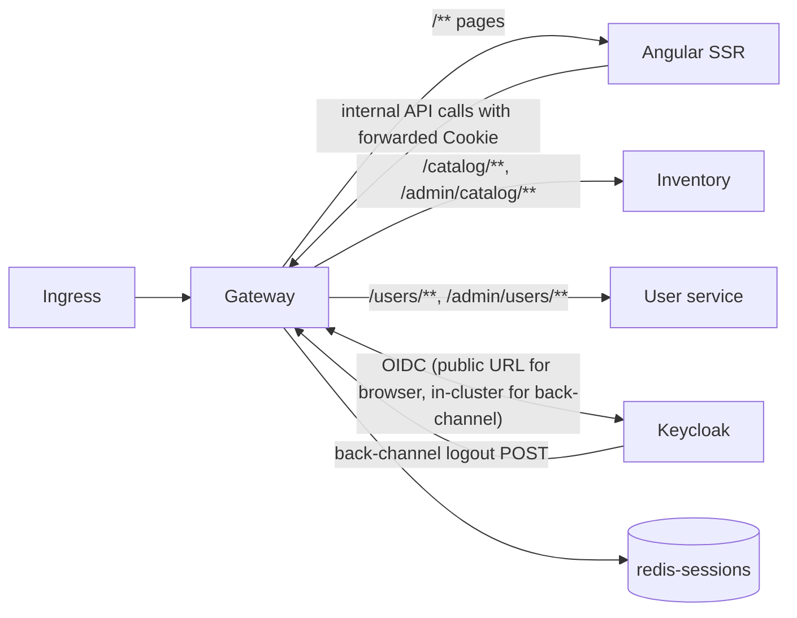

# 01 — Gateway (Backend for Frontend)

| | |
| --- | --- |
| **Status** | Draft v0.2 — assumptions marked `G-xx` need confirmation. v0.2: no route changes; notes for remember‑me (§5.5) and the admin dialogs on `/books` (§6.1) |
| **Module** | `services/gateway` |
| **Depends on** | `00-conventions.md`, `05-keycloak.md` (client `bookstore-gateway`), `06-data-platform.md` (redis‑sessions) |
| **ARCH refs** | §2, §3.1, §3.2, §4.1, §4.3 (SSE pass‑through), §6.3 |

## 1. Purpose and scope

The gateway is the only workload reachable from the ingress. It is a Spring Cloud Gateway application acting as an OAuth2 client (BFF pattern).

**Responsibilities**

- OIDC authorization‑code login with PKCE against Keycloak; tokens stored server‑side only.
- Session cookie (`SESSION`, HttpOnly) backed by `redis-sessions`.
- Token relay to services, with transparent refresh.
- CSRF protection for cookie‑authenticated writes.
- Coarse authorization (anonymous vs signed‑in vs `ADMIN`) per route.
- Routing: API calls to services, everything else to Angular SSR.
- Long‑lived SSE pass‑through without buffering.
- RP‑initiated logout and back‑channel logout across all replicas.
- Small local `/bff/*` endpoints the frontend needs (session info, login with return URL).
- Security response headers.

**Non‑goals (v1)**

- Application‑level rate limiting; per‑IP limits are applied at the ingress ([ADR 0012](../adr/261020-rate-limit-at-the-ingress.md)).
- Response caching.
- Any business logic or response transformation.
- CORS (everything is same‑origin).

## 2. Context



## 3. Interfaces

### 3.1 Technology

- **Spring Cloud Gateway Server, WebFlux variant** (`spring-cloud-starter-gateway-server-webflux` — confirm the exact artifact name in the release train you pick). Chosen over the MVC variant because the gateway mostly holds idle long‑lived SSE connections and relays bytes; the reactive stack handles that with few threads, and `TokenRelay` and Spring Session's reactive Redis support are mature there (G‑01).
- `spring-boot-starter-oauth2-client` (reactive), `spring-session-data-redis` (reactive), Spring Boot 4 Redis starter.
- Route properties live under `spring.cloud.gateway.server.webflux.*` in current releases (older releases used `spring.cloud.gateway.*`); match the version you build with.

### 3.2 Routes

Ordered; first match wins. Local endpoints (Spring Security's `/oauth2/**`, `/login/**`, `/logout`, and the `/bff/**` controllers) are handled by WebFlux handler mappings that run before gateway routes, so they never reach the SSR catch‑all.

| Order | ID | Predicates | Upstream | Filters | Gateway auth rule |
| --- | --- | --- | --- | --- | --- |
| 1 | `catalog-stream` | `Path=/api/catalog/stream`, `Method=GET` | inventory | `StripPrefix=1`, `RemoveRequestHeader=Cookie`; metadata `response-timeout: -1` | permitAll |
| 2 | `catalog-public` | `Path=/api/catalog/**`, `Method=GET,HEAD` | inventory | `StripPrefix=1`, `RemoveRequestHeader=Cookie` | permitAll |
| 3 | `catalog-admin` | `Path=/api/admin/catalog/**` | inventory | `StripPrefix=1`, `TokenRelay=`, `RemoveRequestHeader=Cookie` | `ROLE_ADMIN` |
| 4 | `users-me` | `Path=/api/users/me,/api/users/me/**` | user | `StripPrefix=1`, `TokenRelay=`, `RemoveRequestHeader=Cookie` | authenticated |
| 5 | `users-admin` | `Path=/api/admin/users/**` | user | `StripPrefix=1`, `TokenRelay=`, `RemoveRequestHeader=Cookie` | `ROLE_ADMIN` |
| 6 | `api-unknown` | `Path=/api/**` | — | returns 404 problem (local handler, not SSR) | permitAll |
| 7 | `ssr` | `Path=/**` | SSR | none (Cookie is kept; SSR needs it) | see §6.2 |

Default filter on all routes: `DedupeResponseHeader=Cache-Control`. Add `SaveSession` (persists refreshed tokens before relaying) to the three `TokenRelay` routes only, placed before `TokenRelay`; it must not run on `catalog-stream` because it loads the session (§5.5).

`RemoveRequestHeader=Cookie` on service routes keeps the session cookie away from services that have no use for it.

`api-unknown` exists so a typo in an API path returns JSON 404 instead of an HTML page from SSR.

Upstream URIs from env: `INVENTORY_URI=http://inventory.bookstore-app.svc:8080`, `USER_SERVICE_URI=http://user.bookstore-app.svc:8080`, `SSR_URI=http://web.bookstore-app.svc:4000`.

### 3.3 Local endpoints

#### `GET /bff/session`

Always 200. Also ensures the `XSRF-TOKEN` cookie is set.

```json
{
  "authenticated": true,
  "user": { "sub": "uuid", "username": "amy@example.com", "email": "amy@example.com",
            "name": "Amy Lin", "emailVerified": true },
  "roles": ["USER", "ADMIN"]
}
```

Anonymous: `{ "authenticated": false, "user": null, "roles": [] }`. Data comes from the `OidcUser` in the session (ID token claims); no call to Keycloak or the user service. Response header `Cache-Control: no-store`.

#### `GET /bff/login?returnTo=/books/123`

- Validates `returnTo`: must start with a single `/`, must not start with `//` or `/\`, max 512 chars, no scheme. Invalid → treat as `/`.
- Stores it in the session under `bff.returnTo`, then 302 to `/oauth2/authorization/keycloak`.
- The authentication success handler redirects to `bff.returnTo` (then removes it), falling back to the request saved by Spring Security's request cache, then `/`.

#### `POST /logout`

Spring Security logout (requires CSRF token, sent as form field `_csrf` or header `X-XSRF-TOKEN`). Invalidates the session, then 302 to Keycloak's end‑session endpoint with `id_token_hint` and `post_logout_redirect_uri={baseUrl}/`.

#### `POST /logout/connect/back-channel/keycloak`

Spring Security OIDC back‑channel logout endpoint, called by Keycloak in‑cluster. CSRF‑exempt (Spring Security handles this for the back‑channel endpoint). See §5.4.

### 3.4 Error responses produced by the gateway

| Situation | API paths (`/api/**`, `/bff/**`) | Page paths |
| --- | --- | --- |
| Not signed in, route requires auth | 401 problem JSON, no redirect | 302 `/bff/login?returnTo=<path>` |
| Signed in, lacks role | 403 problem JSON | 302 `/forbidden` (rendered by SSR) |
| CSRF token missing/invalid | 403 problem `csrf-invalid` | 403 problem |
| Upstream unreachable / timeout | 502 / 504 problem `dependency-unavailable` | 502 static HTML |
| Token refresh failed (session effectively expired) | 401 problem `session-expired`; session invalidated | 302 to `/bff/login?returnTo=` |

Problem bodies follow 00 §3.6, produced by a custom `ServerAuthenticationEntryPoint`, `ServerAccessDeniedHandler` and a `ErrorWebExceptionHandler` for upstream failures.

## 4. Data model

The gateway has no database. Session data in `redis-sessions`:

| Key pattern | Content |
| --- | --- |
| `bookstore:session:sessions:<id>` | Spring Session hash: security context (OidcUser), `OAuth2AuthorizedClient` (access + refresh tokens), CSRF token, `bff.returnTo` |
| `bookstore:session:oidc-sid:<sid>` | Set of Spring session IDs for a Keycloak session ID (§5.4) |

Namespace: `spring.session.redis.namespace=bookstore:session`. Sessions are serialized with a JSON serializer (Spring Security's Jackson modules), not JDK serialization, so a library upgrade does not invalidate every session (G‑02).

## 5. Behaviour and flows

### 5.1 Login

Matches ARCH §4.1. Configuration specifics:

```yaml
spring.security.oauth2.client:
  registration.keycloak:
    provider: keycloak
    client-id: ${OIDC_CLIENT_ID}           # bookstore-gateway
    client-secret: ${OIDC_CLIENT_SECRET}
    authorization-grant-type: authorization_code
    redirect-uri: "{baseUrl}/login/oauth2/code/{registrationId}"
    scope: [openid, profile, email]
  provider.keycloak:
    issuer-uri: ${OIDC_ISSUER_URI}         # public URL
```

- **PKCE** for a confidential client: customise the `ServerOAuth2AuthorizationRequestResolver` with `OAuth2AuthorizationRequestCustomizers.withPkce()`. Keycloak's client requires `S256` (05).
- **Issuer discovery** from the public URL happens at startup, so the gateway pod needs egress to the public Keycloak host (via the ingress). If that is undesirable, set `authorization-uri` (public), and `token-uri`, `jwk-set-uri`, `user-info-uri` (in‑cluster) explicitly and drop `issuer-uri` from discovery (G‑03). Either way, the `iss` claim must equal the public URL.
- **Authorities**: a `GrantedAuthoritiesMapper` reads `realm_access.roles` from the ID token (Keycloak mapper adds it there, 05 §3.3) and maps `USER`/`ADMIN` to `ROLE_USER`/`ROLE_ADMIN`.
- `baseUrl` must resolve to `https://shop.bookstore.example`: set `server.forward-headers-strategy=framework` and make sure the ingress sends `X-Forwarded-Proto`, `X-Forwarded-Host`, `X-Forwarded-Port`.
- Session ID is changed on login (WebFlux default: session fixation protection). Keep it.

### 5.2 Token relay and refresh

- `TokenRelay` takes the `OAuth2AuthorizedClient` for the current session via the `ReactiveOAuth2AuthorizedClientManager`. Configure the manager with `authorizationCode()` and `refreshToken()` providers. Clock skew 30 s, so tokens are refreshed shortly before expiry.
- Authorized clients are stored in the web session (`WebSessionServerOAuth2AuthorizedClientRepository`), therefore in Redis, therefore shared by all replicas.
- Refresh failure (`invalid_grant`): remove the authorized client, invalidate the session, return per §3.4.
- Concurrent refreshes from the same session on different replicas can both succeed with Keycloak (refresh token rotation off, 05 §3.4). Last write wins in Redis; both tokens are valid. If refresh token rotation is ever turned on, this needs a per‑session lock.

### 5.3 CSRF

- `CookieServerCsrfTokenRepository.withHttpOnlyFalse()`, cookie `XSRF-TOKEN`, path `/`, `Secure`, `SameSite=Lax`. Header name `X-XSRF-TOKEN` (Angular's default).
- Use `ServerCsrfTokenRequestAttributeHandler` (plain, not the XOR‑masked handler), because Angular sends the raw cookie value.
- The reactive CSRF token is lazy; add a `WebFilter` that subscribes to the `CsrfToken` request attribute on every request so the cookie is always written (otherwise the first POST fails).
- Protected methods: POST, PUT, PATCH, DELETE on all paths. Exempt: `/logout/connect/back-channel/**`.
- SSR only issues GETs, so it never needs a CSRF token.

### 5.4 Logout and back‑channel logout

**RP‑initiated:** `OidcClientInitiatedServerLogoutSuccessHandler` with `postLogoutRedirectUri = "{baseUrl}/"`. The frontend submits a real HTML form (not XHR) because the response is a cross‑origin redirect to Keycloak.

**Back‑channel:** enable `http.oidcLogout(l -> l.backChannel(Customizer.withDefaults()))`.

Spring Security's default `ReactiveOidcSessionRegistry` is **in memory**, and its default logout handler calls the gateway's own `/logout` with the session cookie. With several replicas, Keycloak's call lands on one pod that may not hold the registry entry. Replace both:

1. `RedisOidcSessionRegistry implements ReactiveOidcSessionRegistry`: on login, `SADD bookstore:session:oidc-sid:<sid> <springSessionId>` with the same TTL as the session; `removeSessionInformation(OidcLogoutToken)` returns and deletes the set for the token's `sid` (or all sessions of `sub` if `sid` is absent).
2. A custom back‑channel `ServerLogoutHandler` that deletes those session IDs directly through `ReactiveSessionRepository.deleteById`, instead of calling `/logout` over HTTP.
3. Update the registry when the session ID changes at login.

Keycloak's back‑channel URL points at the in‑cluster Service: `http://gateway.bookstore-app.svc:8080/logout/connect/back-channel/keycloak` (05 §3.2).

### 5.5 Session lifetime

| Setting | Value | Why |
| --- | --- | --- |
| `spring.session.timeout` | 30 min | ≤ Keycloak SSO Session Idle (30 min, 05 §3.4) |
| Cookie | `SESSION`, `HttpOnly`, `Secure`, `SameSite=Lax`, `Path=/`, no `Max-Age` (browser session) | |
| Max lifetime | Enforced by Keycloak SSO Session Max (10 h): refresh fails → re‑login | |
| Remember me | Not a gateway setting. When the user ticked 記住我, Keycloak keeps its SSO session 7 d / 30 d (05 §3.4); after the 30 min gateway idle timeout, `/bff/login` completes without a password prompt | |

Every request through the gateway touches the session, including public catalog calls from a signed‑in browser, so browsing keeps the session alive. SSE connections must not: otherwise each reconnect (every 30 min, 02 §5.6) would extend the session and an idle open tab would keep it alive forever. Give `/api/catalog/stream` its own `SecurityWebFilterChain` (matched first via `securityMatcher`) with `permitAll`, `NoOpServerSecurityContextRepository`, CSRF off and no session creation, so the session is never loaded for the stream.

### 5.6 SSE pass‑through

- The reactive gateway streams by default. Do not apply filters that read or modify the response body on `catalog-stream`.
- Route metadata `response-timeout: -1` disables the gateway's response timeout for this route. Global `spring.cloud.gateway.server.webflux.httpclient.response-timeout: 30s` applies to everything else; `connect-timeout: 2000`.
- Netty HTTP client pool: `max-connections` 10000 for the inventory upstream (matches inventory's SSE capacity, 02 §5.6), `max-idle-time` 60 s, `pending-acquire-timeout` 5 s.
- Ingress settings for `/api/catalog/stream` (Apache APISIX, [ADR 0011](../adr/261020-use-apisix-as-ingress-controller.md)):
  - route timeout `read: 3600`, `send: 60`, `connect: 5` seconds;
  - response buffering off: the upstream sends `X-Accel-Buffering: no`, which nginx‑based proxies honour; also verify that no response‑rewriting plugin is enabled on the route.

### 5.7 Security headers

Added by a global filter on every response (unless an upstream already set the header):

| Header | Value |
| --- | --- |
| `Strict-Transport-Security` | `max-age=31536000; includeSubDomains` |
| `X-Content-Type-Options` | `nosniff` |
| `X-Frame-Options` | `DENY` |
| `Referrer-Policy` | `strict-origin-when-cross-origin` |
| `Permissions-Policy` | `camera=(), microphone=(), geolocation=()` |
| `Content-Security-Policy-Report-Only` | `default-src 'self'; img-src 'self' data:; style-src 'self' 'unsafe-inline'; script-src 'self'; connect-src 'self'; frame-ancestors 'none'; form-action 'self' https://auth.bookstore.example; report-uri /bff/csp-report; report-to csp` |
| `Reporting-Endpoints` | `csp="/bff/csp-report"` |

CSP starts as report‑only because Angular SSR's inline event‑replay script needs a nonce; the frontend doc (04 §6) covers nonce support. Two weeks after go‑live, if the dashboard shows no first‑party violations for 7 days, switch to the enforcing `Content-Security-Policy` header and keep the report‑only header for tightening ([ADR 0013](../adr/261020-ship-csp-report-only-then-enforce.md)).

**`POST /bff/csp-report`** (local endpoint, `permitAll`, CSRF‑exempt, body ≤ 8 KB, rate‑limited at the ingress): accepts `application/csp-report` and `application/reports+json`, logs one structured line `csp.violation` (directive, blocked URI, document URI without query), increments `bookstore.csp.violations{directive}`, returns 204. Never echoes input.

### 5.8 Requests from SSR

SSR calls `http://gateway.bookstore-app.svc:8080/api/...` with the browser's `Cookie` header forwarded and `Host: shop.bookstore.example`. The gateway treats them like browser requests: same session lookup, same token relay. They never trigger login redirects because they are `/api/**` paths (401 instead). Nothing else is special. NetworkPolicy allows SSR → gateway port 8080.

## 6. Security

### 6.1 Authorization rules (`SecurityWebFilterChain`)

```
/actuator/**                 -> not exposed on 8080 (management port only)
/oauth2/**, /login/**        -> permitAll
/bff/**                      -> permitAll
/logout/connect/back-channel/** -> permitAll (token is verified by Spring Security)
/api/catalog/**   GET,HEAD   -> permitAll
/api/admin/**                -> hasRole('ADMIN')
/api/users/**                -> authenticated
/account, /account/**        -> authenticated   (page)
/admin, /admin/**            -> hasRole('ADMIN') (page)
anything else                -> permitAll
```

The entry point and access‑denied handlers choose JSON vs redirect by path prefix (`/api/` or `/bff/` → JSON).

Book and author management has no page route: it is dialogs on the public `/books` page (04 §3.5.3), so its protection is the `/api/admin/**` rule. `/privacy` and `/terms` fall under "anything else".

### 6.2 Other rules

- The gateway never forwards `Authorization` headers from the browser; `RemoveRequestHeader=Authorization` as a default filter before `TokenRelay` runs (TokenRelay sets its own).
- Strip incoming `X-Forwarded-*` headers that the ingress did not set: rely on the ingress to overwrite them, and configure `server.forward-headers-strategy=framework` only (no trust of arbitrary proxies beyond the ingress; NetworkPolicy ensures only the ingress and SSR reach port 8080).
- Body size limit: `spring.codec.max-in-memory-size` is irrelevant for streaming; enforce 6 MB at the ingress and with a gateway `RequestSize` filter (`maxSize=6MB`) on `catalog-admin`, 1 MB on other API routes.

## 7. Configuration

| Env var | Required | Default | Purpose |
| --- | --- | --- | --- |
| `OIDC_ISSUER_URI` | yes | — | `https://auth.bookstore.example/realms/bookstore` |
| `OIDC_CLIENT_ID` | yes | — | `bookstore-gateway` |
| `OIDC_CLIENT_SECRET` | yes | — | From ESO |
| `INVENTORY_URI`, `USER_SERVICE_URI`, `SSR_URI` | yes | — | §3.2 |
| `REDIS_SESSIONS_HOST`, `REDIS_SESSIONS_PORT` | yes | port 6379 | |
| `REDIS_SESSIONS_USERNAME`, `REDIS_SESSIONS_PASSWORD` | yes | — | ACL user `gateway` |
| `SESSION_TIMEOUT` | no | `30m` | Must stay ≤ Keycloak SSO idle |
| `PUBLIC_BASE_URL` | yes | — | `https://shop.bookstore.example`; used in post‑logout redirect and returnTo checks |
| `CSP_ENFORCE` | no | false | Switch report‑only → enforcing |

## 8. Deployment

- Chart `platform/charts/gateway`. 2–6 replicas, HPA on CPU 70 %. Requests 300m / 512Mi, limits 1 CPU / 768Mi (G‑07).
- Service `gateway` port 8080; Ingress targets it for host `shop.bookstore.example`.
- No sticky sessions needed (sessions in Redis).
- On shutdown, open SSE connections are cut; browsers reconnect to another replica.

## 9. Observability

- Spring Cloud Gateway metrics (`spring.cloud.gateway.requests` timer, tags `routeId`, `status`).
- Custom: `bookstore.gateway.login.success`, `bookstore.gateway.login.failure`, `bookstore.gateway.token.refresh` (tag `outcome`), `bookstore.gateway.backchannel.logout` (tag `outcome`), `bookstore.gateway.sessions.redis.errors`.
- Gauge of active SSE streams passing through (count of in‑flight `catalog-stream` requests).
- Alerts: 5xx per route (00), refresh failure ratio > 20 % for 10 min, Redis errors > 0 for 5 min.
- Never log cookies, tokens or `Set-Cookie` headers; configure the agent's HTTP header capture to exclude them (`OTEL_INSTRUMENTATION_HTTP_SERVER_CAPTURE_REQUEST_HEADERS` left unset).

## 10. Failure modes

| Failure | Behaviour |
| --- | --- |
| `redis-sessions` restart (AOF, ARCH §6.3) | Sessions survive if AOF intact. If lost: next request has no session → protected pages redirect to Keycloak, which signs the user straight back in (SSO cookie still valid) |
| `redis-sessions` unavailable | Requests that touch the session fail with 503 problem; public catalog API keeps working only if the browser has no session cookie. Accepted in v1 (no HA) |
| Keycloak down | Existing sessions keep working until the access token needs refresh; new logins fail with 503 page |
| Upstream service down | 502/504 problem for its routes; other routes unaffected |
| SSR down | Pages 502; API still works |

## 11. Testing

Integration tests with Testcontainers Keycloak (realm from 05), Redis, and WireMock (or a tiny test app) for upstreams:

1. Anonymous `GET /api/users/me` → 401 JSON; `GET /account` → 302 to `/bff/login?returnTo=/account`.
2. Full login with a headless HTTP client following redirects and posting Keycloak's login form → `SESSION` cookie; `/bff/session` shows roles; relayed request to WireMock carries a Bearer token with `aud` `bookstore-api`.
3. `returnTo` handling: `/books/1` honoured; `//evil.com`, `https://evil.com`, `/\evil` rejected.
4. POST without CSRF → 403; with `X-XSRF-TOKEN` from cookie → passes.
5. Expired access token is refreshed transparently (shorten token lifespan in test realm to 10 s).
6. Back‑channel logout: two gateway instances sharing Redis; end the Keycloak session via admin API; the session is gone on both.
7. SSE route: upstream emits an event every second for 70 s; the client receives each one within 1 s (proves no buffering and no 30 s timeout).
8. USER token on `/api/admin/**` → 403 JSON; on `/admin` page → 302 `/forbidden`.
9. `Cookie` header absent on requests reaching service upstreams; present on SSR upstream.
10. Unknown `/api/nope` → 404 JSON, not SSR HTML.

## 12. Implementation plan

1. Skeleton with routes to upstreams (no auth), management port, problem error handler.
2. OAuth2 login + PKCE + Redis sessions + `/bff/session`.
3. Authorization rules and JSON/redirect entry points; `/bff/login` with returnTo.
4. TokenRelay + refresh; `RemoveRequestHeader` filters.
5. CSRF.
6. Logout + Redis‑backed back‑channel logout.
7. SSE route tuning; ingress config in the chart.
8. Security headers, request size limits, metrics, chart.

## 13. Assumptions to confirm

| ID | Assumption | If wrong |
| --- | --- | --- |
| G‑01 | **Decided 2026‑10‑20 — [ADR 0001](../adr/261020-use-bff-gateway-with-server-side-tokens.md).** WebFlux variant of Spring Cloud Gateway | MVC variant: `TokenRelay` and session config differ; SSE pass‑through needs careful thread sizing |
| G‑02 | **Decided 2026‑10‑20 — [ADR 0001](../adr/261020-use-bff-gateway-with-server-side-tokens.md).** JSON session serialization | JDK serialization is simpler but breaks sessions on class changes |
| G‑03 | Gateway can reach the public Keycloak URL for discovery | Configure endpoints explicitly (§5.1) |
| G‑04 | **Decided 2026‑10‑20 — [ADR 0011](../adr/261020-use-apisix-as-ingress-controller.md).** Existing ingress is Apache APISIX | Use the equivalent timeout/buffering settings for your controller (not ingress‑nginx: retired upstream in March 2026) |
| G‑05 | **Decided 2026‑10‑20 — [ADR 0013](../adr/261020-ship-csp-report-only-then-enforce.md).** CSP report‑only at launch with `/bff/csp-report`; enforce two weeks after go‑live if no first‑party violations in the last 7 days. Was: CSP report‑only at launch | Enforce from day one once nonce support is done |
| G‑06 | **Decided 2026‑10‑20 — [ADR 0012](../adr/261020-rate-limit-at-the-ingress.md).** Per‑IP rate limiting at the APISIX ingress; no app‑level limiter. Was: No rate limiting in v1 | Add `RequestRateLimiter`; it needs a Redis — do not use `redis-sessions` for it |
| G‑07 | Sizing in §8 | Tune after load test |
| G‑08 | `/bff/session` and `/bff/login` are new endpoints not in ARCH §3.2 | Frontend would need another way to learn login state and roles |
