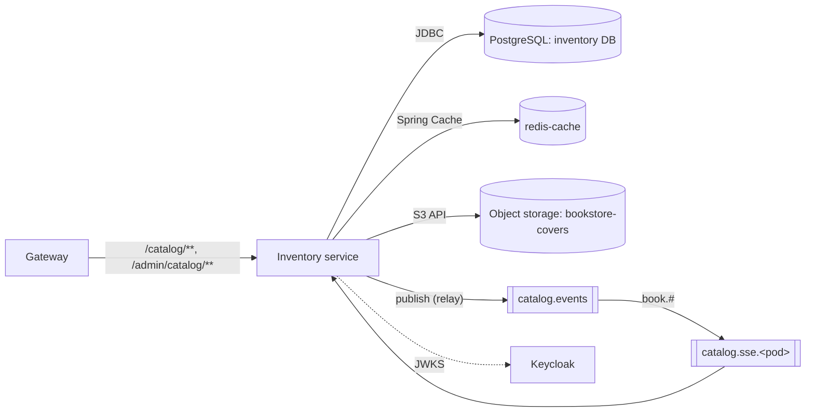

# 02 — Inventory service

| | |
| --- | --- |
| **Status** | Draft v0.2 — assumptions marked `I-xx` need confirmation. v0.2 (from UI mock‑ups, 04 §3.5): book `publishedDate` and `description`, author `nationality` and `bookCount` in lists, offset paging with `total` for book and author lists, genre `SELF_HELP` |
| **Module** | `services/inventory` |
| **Depends on** | `00-conventions.md`, `05-keycloak.md` (roles, audience), `06-data-platform.md` (PostgreSQL, RabbitMQ, redis-cache, object storage) |
| **ARCH refs** | §3.1, §3.3 Inventory, §4.2, §4.3, §6.2 rule 1, §6.4 |

## 1. Purpose and scope

The inventory service owns the book catalog.

**Responsibilities**

- Books, authors and the many‑to‑many link between them.
- Stock level per book (set by admins; nothing decrements it in v1).
- Cover image upload, storage (S3 API) and serving.
- Catalog listing with filtering, sorting, offset pagination with totals (00 §3.3) and search.
- Audit log for every admin write.
- Transactional outbox, relay to RabbitMQ, and consumption of catalog events by every replica.
- Server‑Sent Events stream of catalog changes to browsers.
- Optional read cache in `redis-cache`.

**Non‑goals (v1)**

- Orders, reservations or automatic stock decrement.
- Image resizing or thumbnail generation (I‑05).
- Replaying missed SSE events on reconnect; clients refetch instead.
- Pushing author changes over SSE (author events are published to RabbitMQ but not bound to SSE queues, as in ARCH §4.3).
- Multi‑currency, multi‑language book metadata.

## 2. Context



## 3. Interfaces

All paths are as seen by the service (gateway strips `/api`). DTOs follow 00 §3. `BookView` is defined in 00 §5.3.

### 3.1 Public endpoints (`@PreAuthorize("permitAll()")`)

#### `GET /catalog/books`

| Param | Type | Default | Notes |
| --- | --- | --- | --- |
| `genre` | Genre | — | Exact match |
| `authorId` | UUID | — | Books linked to this author |
| `inStock` | boolean | — | `true` → `stock_quantity > 0` |
| `q` | string, 1–100 chars | — | Search, see §5.3 |
| `sort` | `NEWEST`, `PRICE_ASC`, `PRICE_DESC`, `TITLE_ASC`, `RELEVANCE` | `RELEVANCE` if `q` set, else `NEWEST` | `RELEVANCE` without `q` → 400 |
| `offset` | int 0–10000 | 0 | 00 §3.3 (offset variant) |
| `limit` | int 1–100 | 20 | |

Response `200`: `{ "items": BookView[], "offset": 0, "limit": 20, "total": 132 }`. Soft‑deleted books are never returned. The frontend always passes `sort` explicitly (`TITLE_ASC`, or `RELEVANCE` with `q`; 04 §5.2).

#### `GET /catalog/books/{id}`

`200` `BookView` + `ETag`. `404` if missing or soft‑deleted.

#### `GET /catalog/authors/{id}`

`200` `{ "id", "name", "nationality", "bio", "version" }`. Books by the author: use `GET /catalog/books?authorId=`.

#### `GET /catalog/genres`

`200` `[{ "value": "FANTASY" }, …]` in enum order. Labels are a frontend concern.

#### `GET /catalog/covers/{key}`

`{key}` is the full object key, which contains slashes; map with `/catalog/covers/**` and take the remainder. Streams the object from storage.

- Headers: `Content-Type` from stored metadata, `Content-Length`, `Cache-Control: public, max-age=31536000, immutable`, `ETag` = storage ETag, `X-Content-Type-Options: nosniff`.
- Supports `If-None-Match` → `304`.
- Unknown key → `404` with an empty body (not problem JSON; browsers request this as an image).
- Keys never change content (new upload = new key, §5.5), which is why `immutable` is safe.

#### `GET /catalog/stream`

SSE, `Content-Type: text/event-stream`. See §5.6 for the wire format.

### 3.2 Admin endpoints (`@PreAuthorize("hasRole('ADMIN')")`)

#### Books

| Method and path | Body | Success | Notes |
| --- | --- | --- | --- |
| `GET /admin/catalog/books` | — | 200 offset page of `AdminBookView` | Same params as public list plus `includeDeleted` (default false) |
| `GET /admin/catalog/books/{id}` | — | 200 `AdminBookView` + ETag | Returns soft‑deleted books too |
| `POST /admin/catalog/books` | `BookWrite` | 201 + `Location` + ETag | |
| `PUT /admin/catalog/books/{id}` | `BookWrite` | 200 `AdminBookView` + ETag | Full replace; `If-Match` required |
| `DELETE /admin/catalog/books/{id}` | — | 204 | Soft delete; `If-Match` required |
| `POST /admin/catalog/books/{id}/restore` | — | 200 | Undo soft delete; `If-Match` required; 409 if ISBN now taken |
| `PUT /admin/catalog/books/{id}/cover` | multipart, part `file` | 200 `AdminBookView` + ETag | `If-Match` required; §5.5 |
| `DELETE /admin/catalog/books/{id}/cover` | — | 200 `AdminBookView` + ETag | `If-Match` required |

`BookWrite`:

```json
{
  "isbn": "978-957-33-1724-1",
  "title": "…",
  "genre": "FANTASY",
  "price": "450.00",
  "pageCount": 320,
  "stockQuantity": 12,
  "publishedDate": "2001-06-01",
  "description": "…",
  "authorIds": ["uuid", "uuid"]
}
```

| Field | Rule | Error code |
| --- | --- | --- |
| `isbn` | Required. Hyphens and spaces stripped. ISBN‑13 with valid check digit, or ISBN‑10 with valid check digit (converted to ISBN‑13 `978` prefix before storage) (I‑01) | `invalid-isbn` |
| `title` | Required, 1–300 chars after trim | `invalid-length` |
| `genre` | Required, Genre enum | `invalid-enum` |
| `price` | Required, string decimal, `0.00`–`99999999.99`, max 2 decimals | `out-of-range`, `invalid-decimal` |
| `pageCount` | Optional, 1–20000 | `out-of-range` |
| `stockQuantity` | Required, 0–1000000 | `out-of-range` |
| `publishedDate` | Required, `yyyy-MM-dd`, between `1450-01-01` and today (Asia/Taipei) | `invalid-date`, `out-of-range` |
| `description` | Optional (`null` clears), ≤ 5000 chars after trim, plain text | `invalid-length` |
| `authorIds` | Required, 1–20 distinct UUIDs, each an existing author | `unknown-author` |

ISBN uniqueness is among non‑deleted books. Duplicate → 409 `isbn-taken` with `detail` naming the conflicting book ID.

`AdminBookView` = `BookView` + `stockQuantity`, `coverImageKey`, `deletedAt`, `createdBy`, `updatedBy` (usernames).

#### Authors

| Method and path | Body | Success | Notes |
| --- | --- | --- | --- |
| `GET /admin/catalog/authors?q=&offset=&limit=` | — | 200 offset page of `AuthorView` | Sorted by `lower(name)`, id; `q` is a case‑insensitive substring match on name. Used by the Manage Authors dialog and the book form's author select (04 §5.6–5.7) |
| `GET /admin/catalog/authors/{id}` | — | 200 `AuthorView` + ETag | |
| `POST /admin/catalog/authors` | `AuthorWrite` | 201 + `Location` + ETag | |
| `PUT /admin/catalog/authors/{id}` | `AuthorWrite` | 200 + ETag | `If-Match`; renaming refreshes the search text of linked books (§5.3) |
| `DELETE /admin/catalog/authors/{id}` | — | 204 | `If-Match`; 409 `author-in-use` if linked to any non‑deleted book. Hard delete (I‑02) |

`AuthorWrite` = `{ "name", "nationality", "bio" }`: `name` required 1–200 chars; `nationality` optional ISO 3166‑1 alpha‑2, uppercase (`invalid-country`); `bio` optional, max 5000 chars. Author names are not unique (two authors can share a name).

`AuthorView` = `{ "id", "name", "nationality", "bio", "bookCount", "version" }`. `bookCount` counts non‑deleted linked books; on list pages it is computed with one grouped query for the page's author IDs.

#### Audit

`GET /admin/catalog/audit?entityType=&entityId=&actorSub=&from=&to=&limit=&cursor=` → keyset page of audit records (00 §6), newest first.

### 3.3 Service‑specific problem codes

`invalid-isbn`, `isbn-taken`, `unknown-author`, `author-in-use`, `invalid-date`, `invalid-country`, `invalid-image`, `image-too-large`, `storage-unavailable`, `sse-capacity`.

### 3.4 Events

Produces every event type in 00 §5.3. Consumes `book.#` from its own per‑pod queue.

## 4. Data model

Flyway migrations in `src/main/resources/db/migration`. The application DB user owns the schema `inventory`. Set `search_path=inventory`.

### V1__extensions.sql

```sql
CREATE EXTENSION IF NOT EXISTS pg_trgm;   -- trusted extension (PG13+): the DB owner can create it
```

### V2__catalog.sql

```sql
CREATE TABLE author (
  id          uuid PRIMARY KEY,
  name        text NOT NULL CHECK (char_length(name) BETWEEN 1 AND 200),
  nationality char(2) CHECK (nationality ~ '^[A-Z]{2}$'),
  bio         text CHECK (char_length(bio) <= 5000),
  created_at  timestamptz NOT NULL,
  updated_at  timestamptz NOT NULL,
  version     integer NOT NULL DEFAULT 0
);
CREATE INDEX author_name_trgm ON author USING gin (lower(name) gin_trgm_ops);
CREATE INDEX author_name_id ON author (lower(name), id);

CREATE TABLE book (
  id               uuid PRIMARY KEY,
  isbn             char(13) NOT NULL,
  title            text NOT NULL CHECK (char_length(title) BETWEEN 1 AND 300),
  genre            text NOT NULL CHECK (genre IN ('FICTION','FANTASY','SCIENCE_FICTION','MYSTERY','ROMANCE',
                     'HISTORY','BIOGRAPHY','BUSINESS','SCIENCE','COMPUTING','CHILDREN','COMICS','SELF_HELP','OTHER')),
  price            numeric(10,2) NOT NULL CHECK (price >= 0),
  page_count       integer CHECK (page_count BETWEEN 1 AND 20000),
  stock_quantity   integer NOT NULL CHECK (stock_quantity >= 0),
  published_date   date NOT NULL,
  description      text CHECK (char_length(description) <= 5000),
  cover_image_key  text,
  search_text      text NOT NULL DEFAULT '',          -- lower(title || ' ' || author names); maintained by app
  search_vector    tsvector NOT NULL DEFAULT ''::tsvector,
  deleted_at       timestamptz,
  created_at       timestamptz NOT NULL,
  updated_at       timestamptz NOT NULL,
  created_by       text NOT NULL,
  updated_by       text NOT NULL,
  version          integer NOT NULL DEFAULT 0
);
CREATE UNIQUE INDEX book_isbn_live ON book (isbn) WHERE deleted_at IS NULL;
CREATE INDEX book_created ON book (created_at DESC, id DESC) WHERE deleted_at IS NULL;
CREATE INDEX book_price   ON book (price, id)              WHERE deleted_at IS NULL;
CREATE INDEX book_title   ON book (lower(title), id)       WHERE deleted_at IS NULL;
CREATE INDEX book_genre   ON book (genre)                  WHERE deleted_at IS NULL;
CREATE INDEX book_search_vector ON book USING gin (search_vector);
CREATE INDEX book_search_trgm   ON book USING gin (search_text gin_trgm_ops);

CREATE TABLE book_author (
  book_id    uuid NOT NULL REFERENCES book(id),
  author_id  uuid NOT NULL REFERENCES author(id),
  position   smallint NOT NULL,                     -- display order as submitted
  PRIMARY KEY (book_id, author_id)
);
CREATE INDEX book_author_author ON book_author (author_id);
```

Deviations from ARCH §3.3, all deliberate: `published_date`, `description`, `author.nationality` (UI mock‑ups, I‑10), `deleted_at` (soft delete, I‑02), `search_text` (search covers author names and substrings, §5.3), `created_by`/`updated_by`, `book_author.position`. The trigram index is on `search_text` instead of `title` alone.

### V3__outbox_audit.sql

```sql
CREATE TABLE outbox (
  id              uuid PRIMARY KEY,               -- = eventId
  aggregate_type  text NOT NULL,
  aggregate_id    uuid NOT NULL,
  event_type      text NOT NULL,                  -- = routing key
  payload         jsonb NOT NULL,                 -- full envelope as published
  trace_context   jsonb,                          -- {"traceparent": "...", "tracestate": "..."}
  created_at      timestamptz NOT NULL,
  published_at    timestamptz,
  attempts        integer NOT NULL DEFAULT 0,
  last_error      text
);
CREATE INDEX outbox_unpublished ON outbox (created_at) WHERE published_at IS NULL;

CREATE TABLE audit_log (
  id              uuid PRIMARY KEY,
  occurred_at     timestamptz NOT NULL,
  actor_sub       text NOT NULL,
  actor_username  text NOT NULL,
  action          text NOT NULL,
  entity_type     text NOT NULL,
  entity_id       text NOT NULL,
  changes         jsonb,
  trace_id        text
);
CREATE INDEX audit_entity ON audit_log (entity_type, entity_id, occurred_at DESC);
CREATE INDEX audit_time   ON audit_log (occurred_at DESC, id DESC);
CREATE INDEX audit_actor  ON audit_log (actor_sub, occurred_at DESC);
```

Grant: the app role has `SELECT, INSERT` only on `audit_log` (no `UPDATE`/`DELETE`), via a migration that runs `REVOKE`. Flyway runs as the same owner role in v1 (I‑06); a separate migration role is an option later.

### JPA mapping notes

- UUIDs generated in Java (`UUID.randomUUID()` v4; or v7 if a library is already present) so the ID exists before flush and can go into the outbox row.
- `@Version int version` on `Book` and `Author`.
- `Book.authors` mapped through an explicit `BookAuthor` entity (to keep `position`), not `@ManyToMany`.
- `price` → `BigDecimal` with `@Column(precision = 10, scale = 2)`.
- `search_text` and `search_vector` are not mapped as writable fields; they are set by native SQL (§5.3).
- Hikari: `maximumPoolSize` 20 (I‑07). With virtual threads, the pool is the concurrency limit for DB work; keep it explicit.

## 5. Behaviour and flows

### 5.1 Admin write (create, update, delete)

One `@Transactional` service method per operation:

1. Load entity (for update/delete). Compare `If-Match` with `version` → 412 if different.
2. Validate (§3.2); resolve `authorIds` with one `SELECT … WHERE id IN (…)`; missing → 400 `unknown-author`.
3. Compute a field diff (old vs new) for the audit record and `changedFields`.
4. Apply changes; set `updated_at`, `updated_by`.
5. Flush, then run the search refresh SQL for this book (§5.3).
6. Insert `audit_log` row.
7. Insert outbox row(s) (00 §5.3 rule: two rows if price changed). Capture the current trace context into `trace_context` using the OpenTelemetry API's W3C propagator.
8. Register an `afterCommit` hook that evicts this book's cache entries locally (§5.4) and wakes the relay (§5.2).

A PUT that changes nothing still bumps `version`? **No**: if the diff is empty, return 200 with the current state and write no audit or outbox rows.

Unique violation on `book_isbn_live` → 409 `isbn-taken` (catch `DataIntegrityViolationException`, check constraint name).

### 5.2 Outbox relay

Implemented as a scheduled job (chosen over Spring Modulith externalization, I‑03, because it keeps the publish path explicit and easy to test).

```
every 500 ms (fixedDelay), and immediately when woken by an afterCommit hook:
  BEGIN
  SELECT * FROM outbox
   WHERE published_at IS NULL
   ORDER BY created_at
   LIMIT 100
   FOR UPDATE SKIP LOCKED;
  for each row:
     restore trace context from trace_context; start span "outbox publish"
     rabbitTemplate.invoke(ops -> { ops.convertAndSend("catalog.events", row.event_type, body, props);
                                    ops.waitForConfirmsOrDie(5_000); })
     on success: UPDATE outbox SET published_at = now() WHERE id = ?
     on failure: UPDATE outbox SET attempts = attempts + 1, last_error = ? WHERE id = ?; stop this batch
  COMMIT
```

- `SKIP LOCKED` makes the relay safe on every replica at once; no leader election.
- Rows are published in `created_at` order within a batch. Across replicas, order is not guaranteed; consumers rely on `aggregateVersion` (00 §5.5).
- Publisher confirms: `publisher-confirm-type: simple` for the `invoke`/`waitForConfirmsOrDie` pattern above; `mandatory: true` with a returns callback that logs and counts unroutable messages (`bookstore.outbox.unroutable`). An unroutable message is still marked published: it reached the broker, and the exchange simply had no bindings.
- Backoff: after a failed batch, the relay waits `min(30 s, 500 ms × 2^consecutiveFailures)`.
- Cleanup job, daily at 03:00 (cluster time zone), with a cluster‑wide lock via `pg_try_advisory_lock`: delete published rows older than 7 days.
- Wake‑up is in‑process only (a `Semaphore` or `LockSupport.unpark`); other replicas pick rows up on their next tick.

### 5.3 Search

**Catalog language assumption (I‑04):** titles and author names are mixed Traditional Chinese and English. PostgreSQL text search does not segment Chinese, so search combines two mechanisms:

1. **Full‑text** (`simple` configuration, no stemming) — good for English words and whole Chinese runs separated by spaces or punctuation.
2. **Trigram substring match** on `search_text` — handles Chinese substrings and partial English words. Requires the database to have a UTF‑8 encoding and a non‑C locale or ICU collation so `pg_trgm` treats CJK characters as word characters (06 §3.2 sets this).

Search text refresh (called in step 5 of §5.1, and for all linked books when an author is renamed):

```sql
UPDATE book b SET
  search_text = lower(b.title || ' ' || coalesce(a.names, '')),
  search_vector = to_tsvector('simple', b.title || ' ' || coalesce(a.names, ''))
FROM (
  SELECT ba.book_id, string_agg(au.name, ' ' ORDER BY ba.position) AS names
  FROM book_author ba JOIN author au ON au.id = ba.author_id
  WHERE ba.book_id = ANY(:bookIds)
  GROUP BY ba.book_id
) a
WHERE b.id = a.book_id;
```

Author rename touches every linked book in the same transaction and emits `book.updated` for each (with `changedFields: ["authors"]`). If an author has more than 500 books, the rename is still a single transaction; acceptable at expected catalog size (I‑08).

Search query (offset paging, ordered by `score DESC, id DESC`):

```sql
SELECT b.*, round((ts_rank(b.search_vector, websearch_to_tsquery('simple', :q))
                 + similarity(b.search_text, lower(:q)))::numeric, 6) AS score
FROM book b
WHERE b.deleted_at IS NULL
  AND (b.search_vector @@ websearch_to_tsquery('simple', :q)
       OR b.search_text LIKE '%' || :qEscapedLower || '%')
  AND (:genre IS NULL OR b.genre = :genre)
  -- … other filters
ORDER BY score DESC, b.id DESC
OFFSET :offset LIMIT :limit;
```

- `:qEscapedLower` = lowercased `q` with `\`, `%`, `_` escaped.
- Queries shorter than 3 characters cannot use the trigram index and fall back to a sequential scan. That is acceptable below roughly 100k books; log a warning metric `bookstore.search.short_query` so the cost is visible.
- `total`: a second query `SELECT count(*)` with the same `WHERE` clause, run in the same read‑only transaction (`REPEATABLE READ`) so page and total agree. Both are cached together in `book-page` (§5.4).
- Implement list and search queries with `JdbcClient` and hand‑written SQL (not JPA criteria), mapped into the same `BookView` assembler. Authors for a page are loaded with one extra query `WHERE book_id = ANY(:ids)`.

Ordering for the other sorts (the `id` tie‑breaker keeps pages stable; each has a matching partial index in V2):

| Sort | ORDER BY |
| --- | --- |
| `NEWEST` | `created_at DESC, id DESC` |
| `PRICE_ASC` | `price ASC, id ASC` |
| `PRICE_DESC` | `price DESC, id DESC` |
| `TITLE_ASC` | `lower(title) ASC, id ASC` |

### 5.4 Read cache

Spring Cache backed by `redis-cache` (00 §7 env vars `REDIS_CACHE_*`).

| Cache | Key | TTL | Content |
| --- | --- | --- | --- |
| `book` | `book::<id>` | 10 min | `BookView` |
| `book-page` | `book-page::<sha256 of normalised params>` | 2 min | list page response |

- Normalise params before hashing: sorted keys, defaults filled in, `q` trimmed and lowercased.
- Values are JSON (Jackson 3 serializer), not JDK serialization. Key prefix `inventory:v1:` so a format change can bump `v1`.
- Eviction on a catalog event (§5.6 consumer) and on local commit: evict `book::<id>`, and clear `book-page` entirely (scan by prefix in batches of 500 with `SCAN`, never `KEYS`). Every replica receives every event; redundant evictions are harmless.
- `CacheErrorHandler` logs at WARN and counts `bookstore.cache.errors`; a Redis failure must never fail a request. Connection timeout 200 ms, command timeout 200 ms.
- Admin endpoints never read from cache.
- Cache can be disabled with `CACHE_ENABLED=false` (uses `NoOpCacheManager`).

### 5.5 Cover images

Interface (ARCH §6.2 rule 1):

```java
public interface CoverImageStore {
  void put(String key, InputStream data, long contentLength, String contentType);
  Optional<StoredObject> get(String key);      // StoredObject: InputStream, contentType, contentLength, etag
  void delete(String key);
}
```

`S3CoverImageStore` uses the AWS SDK v2 `S3Client` with `endpointOverride(S3_ENDPOINT)` and `forcePathStyle(S3_PATH_STYLE)` from config. No other class imports the AWS SDK.

Upload flow (`PUT /admin/catalog/books/{id}/cover`):

1. Check `If-Match`. Reject if the book is soft‑deleted (409 `book-deleted`).
2. Size ≤ 5 MB (I‑05), else 413 `image-too-large`. Spring multipart limits: `max-file-size 5MB`, `max-request-size 6MB`.
3. Detect the type from magic bytes, not the client's `Content-Type`: JPEG (`FF D8 FF`), PNG (`89 50 4E 47`), WebP (`RIFF....WEBP`). Anything else → 415 `invalid-image`. Read dimensions with `javax.imageio` (WebP via a reader plugin such as TwelveMonkeys); reject images larger than 4000 × 4000 px or smaller than 100 × 100 px.
4. Key: `covers/<bookId>/<uuid>.<ext>`.
5. `put` to storage **before** the DB transaction. If storage fails → 503 `storage-unavailable`, nothing changed.
6. Transaction: set `cover_image_key`, audit `COVER_UPLOAD`, outbox `book.updated` with `changedFields: ["coverUrl"]`.
7. After commit: delete the previous key (best effort, failures logged). If the transaction fails, delete the just‑uploaded key (best effort).
8. Orphaned objects from crashes between steps are acceptable in v1; a cleanup job is a later item.

`coverUrl` in views = `COVER_BASE_URL + "/" + key` when a key exists, otherwise `null`. Default `COVER_BASE_URL=/api/catalog/covers`, which makes the URL same‑origin through the gateway; a CDN later only changes this value (ARCH §7).

Images are stored as uploaded (EXIF metadata is not stripped in v1, I‑05).

### 5.6 Event consumption and SSE

**Queue per replica.** At startup, declare (via `RabbitAdmin`):

- queue `catalog.sse.${POD_NAME}`: exclusive, auto‑delete, non‑durable, `x-max-length: 10000`, `x-overflow: drop-head`;
- binding to `catalog.events` with routing key `book.#`.

`POD_NAME` comes from the Downward API. Locally, fall back to `local-<random>`.

A single `@RabbitListener` (concurrency 1, prefetch 50, auto ack) on that queue:

1. Deserialize the envelope. Unparseable → log ERROR and drop (exclusive queues have no DLX; ARCH's DLX applies to durable consumer queues only).
2. Deduplicate: in‑memory LRU of the last 10,000 `eventId`s.
3. Evict cache entries (§5.4).
4. Broadcast to all local SSE emitters.

**Emitter registry.** `SseEmitterRegistry` holds emitters in a `ConcurrentHashMap<UUID, SseEmitter>`.

- `GET /catalog/stream` creates `new SseEmitter(30 minutes)`. On timeout, completion or error, remove it. The browser reconnects automatically.
- Capacity: `SSE_MAX_CONNECTIONS` per pod (default 5000). Beyond it → 503 problem `sse-capacity` with `Retry-After: 5`.
- Response headers: `Cache-Control: no-store`, `X-Accel-Buffering: no` (disables buffering in nginx‑based proxies, including APISIX).
- First message on connect: `retry: 3000` and `event: ready` with `data: {"serverTime": "…"}`.
- Heartbeat: a scheduled task sends the comment line `: ping` to every emitter every 15 s (ARCH §4.3). Failures remove the emitter.
- Broadcast sends happen on a virtual‑thread executor, one task per emitter, so one slow client cannot block others. Send timeout is not available on `SseEmitter`; rely on the write failure plus the heartbeat to detect dead clients.
- On graceful shutdown, complete all emitters so clients reconnect to another pod.

**Wire format** for each event:

```
id: 0b0c7f6e-3e0a-4b3c-9a37-3a6f1a7f3e21
event: book.price-changed
data: {"eventId":"0b0c…","eventType":"book.price-changed","aggregateId":"7b4e…","aggregateVersion":4,"occurredAt":"…","payload":{…}}

```

`data` is the envelope without `schemaVersion` and `aggregateType` (single line JSON). If the browser sends `Last-Event-ID`, ignore it (no replay); the client refetches on reconnect (04 §5.5).

## 6. Security

- Resource server per 00 §4. Public endpoints: `GET /catalog/**`. Everything under `/admin/catalog/**` requires `ROLE_ADMIN`.
- The service trusts only the JWT, never headers like `X-User`.
- Object storage credentials are scoped to the `bookstore-covers` bucket.
- Cover responses set `Content-Type` only from server‑side detection and `X-Content-Type-Options: nosniff`, so an uploaded file cannot be served as HTML.
- SQL uses bound parameters only; `LIKE` input is escaped (§5.3).

## 7. Configuration

| Env var | Required | Default | Purpose |
| --- | --- | --- | --- |
| `DB_URL` | yes | — | `jdbc:postgresql://pg-main-rw.bookstore-data.svc:5432/inventory` |
| `DB_USERNAME`, `DB_PASSWORD` | yes | — | From CNPG app secret via ESO |
| `DB_POOL_SIZE` | no | 20 | Hikari max pool |
| `RABBITMQ_HOST`, `RABBITMQ_PORT`, `RABBITMQ_VHOST` | yes | port 5672, vhost `bookstore` | |
| `RABBITMQ_USERNAME`, `RABBITMQ_PASSWORD` | yes | — | User `inventory` |
| `REDIS_CACHE_HOST`, `REDIS_CACHE_PORT` | if cache enabled | port 6379 | |
| `REDIS_CACHE_USERNAME`, `REDIS_CACHE_PASSWORD` | if cache enabled | — | ACL user `inventory` |
| `CACHE_ENABLED` | no | true | |
| `S3_ENDPOINT` | no | — (AWS default) | e.g. `http://garage.bookstore-data.svc:3900` |
| `S3_REGION` | yes | — | Garage: its configured region, e.g. `garage` |
| `S3_PATH_STYLE` | no | false | `true` for self‑hosted stores |
| `S3_BUCKET` | yes | — | `bookstore-covers` |
| `S3_ACCESS_KEY_ID`, `S3_SECRET_ACCESS_KEY` | yes on‑prem | — | On AWS, prefer IRSA/Pod Identity and leave these unset |
| `COVER_BASE_URL` | no | `/api/catalog/covers` | |
| `OIDC_ISSUER_URI`, `OIDC_JWK_SET_URI` | yes | — | 00 §4 |
| `POD_NAME` | yes in k8s | `local-<random>` | Downward API |
| `SSE_MAX_CONNECTIONS` | no | 5000 | |
| `SSE_HEARTBEAT_SECONDS` | no | 15 | |
| `OUTBOX_POLL_MS` | no | 500 | |

Other settings: `spring.threads.virtual.enabled=true`; `server.tomcat.max-connections=10000` (SSE holds connections); `spring.mvc.async.request-timeout=-1` (the emitter sets its own timeout).

## 8. Deployment

- Helm chart `platform/charts/inventory`. Deployment, 2–6 replicas; HPA on CPU 70 %.
- Resources (start): requests 500m CPU / 768Mi, limits 2 CPU / 1Gi (I‑07).
- `POD_NAME` from `metadata.name`.
- `terminationGracePeriodSeconds: 30`; on SIGTERM the emitter registry completes all streams first.
- Flyway runs at startup. Two replicas starting together is safe (Flyway takes a lock).
- NetworkPolicy egress: PostgreSQL (inventory DB), RabbitMQ, redis‑cache, object storage, Keycloak JWKS, OTel collector, DNS.

## 9. Observability

Custom metrics:

| Metric | Type | Meaning |
| --- | --- | --- |
| `bookstore.outbox.lag.seconds` | gauge | Age of the oldest unpublished outbox row (0 if none). Query every 15 s |
| `bookstore.outbox.published` | counter | Rows published, tag `event_type` |
| `bookstore.outbox.publish.failures` | counter | |
| `bookstore.outbox.unroutable` | counter | |
| `bookstore.sse.connections` | gauge | Open emitters on this pod |
| `bookstore.sse.events.sent` | counter | Tag `event_type` |
| `bookstore.cache.errors` | counter | |
| `bookstore.search.short_query` | counter | |

Spans: the agent covers HTTP, JDBC and AMQP. Add manual spans for `outbox publish` (child of the stored request context, so a trace goes admin PUT → outbox → RabbitMQ → consumer) and `sse broadcast`.

Alerts (PrometheusRule in the chart): outbox lag > 60 s for 2 min; publish failures > 0 for 5 min; SSE connections > 80 % of max for 10 min; 5xx ratio > 2 % for 5 min on any route.

Dashboard panels: request rate/latency by route, Hikari active/pending, outbox lag, events published by type, SSE connections per pod, cache hit ratio (`cache_gets_total` by result).

## 10. Failure modes

| Failure | Behaviour |
| --- | --- |
| PostgreSQL down | Readiness fails; requests 503. SSE streams stay open (they don't need the DB) |
| RabbitMQ down | Admin writes still succeed (outbox). Relay retries with backoff; lag alert fires. SSE queue lost; on reconnect the listener container redeclares the queue; clients may miss events until then (the TTL backstop and client refetch on reconnect cover it) |
| redis‑cache down | All reads go to Postgres; WARN logs; no user impact |
| Object storage down | Cover GET returns 503; frontend shows placeholder. Upload returns 503 `storage-unavailable` |
| Pod killed | Its exclusive SSE queue is deleted; its clients reconnect to other pods and refetch |
| Duplicate event delivery | LRU dedupe; eviction and broadcast are idempotent anyway |

## 11. Testing

Integration tests (Testcontainers PostgreSQL, RabbitMQ, Redis, an S3‑compatible container, Keycloak or a JWT signed by a test key):

1. Create book → row, audit row, one outbox row; relay publishes; message on a test queue bound to `book.#` has correct properties and headers.
2. Update price → two outbox rows (`book.updated`, `book.price-changed`).
3. PUT without `If-Match` → 428; with stale version → 412; no-op PUT → no audit/outbox rows.
4. ISBN: ISBN‑10 input stored as ISBN‑13; bad check digit → 400; duplicate live ISBN → 409; duplicate after soft delete → allowed.
5. Offset pagination for each sort walks a static dataset with no duplicates or gaps, including ties in price; `total` matches the filter; `offset` > 10000 → 400.
5a. `publishedDate` in the future → 400; `nationality` `usa` → 400 `invalid-country`; author list returns correct `bookCount` excluding soft‑deleted books.
6. Search: Chinese substring (`哈利` finds `哈利波特`), English word, author name, mixed query; `%` in query is literal.
7. SSE: connect two clients to the app, publish an event, both receive it with `id:` and `event:`; heartbeat arrives within 20 s.
8. Two app instances against one RabbitMQ: an update on instance A reaches an SSE client on instance B.
9. Cache: second GET served from cache; event eviction makes the next GET hit Postgres; Redis stopped → GET still 200.
10. Cover: PNG accepted, served with `immutable`; HTML file renamed `.png` rejected 415; 6 MB file → 413; old key deleted after replacement.
11. Security: every admin route 401 without token, 403 with USER token.
12. Audit: `audit_log` UPDATE by the app role fails (permission denied).

## 12. Implementation plan

1. Skeleton: Boot app, security‑common wiring, problem handler, health, Flyway V1–V3, Testcontainers dev run.
2. Authors CRUD + audit.
3. Books CRUD (no covers, no search) with ETag/If-Match, ISBN rules, soft delete, audit.
4. Public list with filters, sorts and offset paging with `total`; `GET /catalog/books/{id}`.
5. Search text refresh + search query.
6. Outbox writes + relay + publisher confirms + trace propagation.
7. Per‑pod queue consumer + SSE endpoint + heartbeat.
8. Redis cache + event eviction.
9. Covers (store interface, S3 impl, upload, serve).
10. Metrics, alerts, dashboard, Helm chart, committed `openapi.yaml`.

## 13. Assumptions to confirm

| ID | Assumption | If wrong |
| --- | --- | --- |
| I‑01 | ISBN‑10 input accepted and converted to ISBN‑13 | Reject ISBN‑10: simpler validator |
| I‑02 | Books soft‑deleted (restorable); authors hard‑deleted and only when unused | Hard delete books: drop `deleted_at`, partial indexes become plain |
| I‑03 | **Decided 2026‑10‑20 — [ADR 0007](../adr/261020-use-hand-written-outbox-relay.md).** Scheduled outbox relay rather than Spring Modulith | Replace §5.2 with Modulith event publication registry + AMQP externalization |
| I‑04 | **Decided 2026‑10‑20 — [ADR 0008](../adr/261020-keep-pg-trgm-and-fts-for-search.md).**  Requires an explicit Unicode‑aware `LC_CTYPE` at initdb (06 §3.1). Titles/authors mixed Traditional Chinese and English; trigram + `simple` FTS is good enough | If search quality matters more, plan the dedicated search engine (ARCH §7) earlier, or evaluate `pg_bigm` |
| I‑05 | Covers: JPEG/PNG/WebP, ≤ 5 MB, ≤ 4000 px, stored as uploaded, no resizing, no EXIF stripping | Add an image‑processing step before upload (resize, re‑encode, strip metadata) |
| I‑06 | Flyway runs as the app's owner role | Separate migration Job with a privileged role |
| I‑07 | Sizing: pool 20, 2–6 replicas, 500m/768Mi requests | Tune after load test |
| I‑08 | Catalog well under 100k books; author with > 500 books rare | Batch author‑rename refresh asynchronously |
| I‑09 | Public views show `inStock` boolean only, not quantity | Add `stockQuantity` to `BookView` and events |
| I‑10 | `publishedDate` required (first publication of this edition), `description` optional plain text; author `nationality` is an ISO country code shown as a localised name | Make `publishedDate` optional; store nationality as free text |
