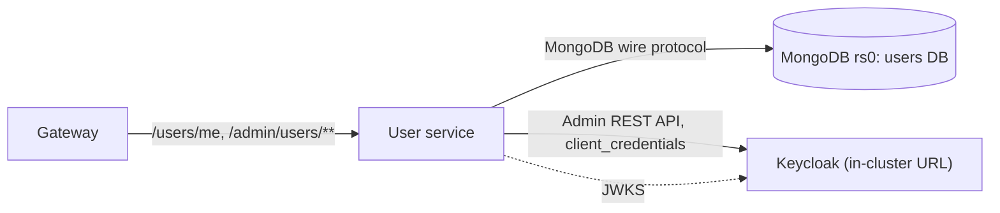

# 03 — User service

| | |
| --- | --- |
| **Status** | Draft v0.2 — assumptions marked `U-xx` need confirmation. v0.2 (from UI mock‑ups, 04 §3.5.7–3.5.8): users edit first/last name in the app (written through to Keycloak); the optional address captured at registration seeds the profile |
| **Module** | `services/user` |
| **Depends on** | `00-conventions.md`, `05-keycloak.md` (realm, client `bookstore-user-service`), `06-data-platform.md` (MongoDB) |
| **ARCH refs** | §3.1, §3.3 Users, §4.1 (lazy profile creation, admin client) |

## 1. Purpose and scope

**Responsibilities**

- App‑specific profile data per Keycloak user: display name, phone, address, preferences.
- `GET/PUT /users/me` for the signed‑in user, with lazy profile creation on first call.
- Admin user management, delegated to the Keycloak Admin REST API: search, view, create (with invitation email), change roles, enable/disable, send password‑reset email.
- Audit log of admin actions.

**Ownership split** (ARCH §3.3, made explicit):

| Data | Owner | Editable by user | Editable by admin |
| --- | --- | --- | --- |
| Username, email, password, email verification | Keycloak | Keycloak Account Console (U‑01) | Created by admin at account creation; later edits in Keycloak admin console (U‑02) |
| First/last name | Keycloak | App profile page via `PUT /users/me`, written through to Keycloak (§5.2) | As above |
| Registration address (`reg_address_*` user attributes) | Keycloak, transient | Registration form only (05 §3.5) | No; moved into the profile and cleared at first `GET /users/me` (§5.1) |
| Realm roles `USER`, `ADMIN` | Keycloak | No | This service (`PUT /admin/users/{id}/roles`) |
| Enabled flag | Keycloak | No | This service |
| `displayName`, `phone`, `address`, `preferences` | This service (MongoDB) | `PUT /users/me` | No (U‑03) |

`displayName` is the name shown in the app (reviews, greetings later). It defaults to the Keycloak `name` claim at first login and is independent afterwards. The legal first/last name stays in Keycloak.

**Non‑goals (v1)**

- Self‑service account deletion (U‑04).
- Admin editing of a customer's profile fields.
- Hard deletion of Keycloak users from the app (disable instead).
- Syncing Keycloak changes into MongoDB (nothing is duplicated, so nothing to sync).

## 2. Context



## 3. Interfaces

### 3.1 `GET /users/me` — `@PreAuthorize("hasRole('USER')")`

Creates the profile on first call (§5.1). Response `200` + `ETag: "<profile.version>"`:

```json
{
  "id": "keycloak-sub-uuid",
  "username": "amy@example.com",
  "email": "amy@example.com",
  "emailVerified": true,
  "firstName": "Amy",
  "lastName": "Lin",
  "roles": ["USER"],
  "accountConsoleUrl": "https://auth.bookstore.example/realms/bookstore/account",
  "profile": {
    "displayName": "Amy",
    "phone": "+886912345678",
    "address": {
      "line1": "忠孝東路四段 100 號 5 樓", "line2": null,
      "district": "大安區", "city": "台北市", "postalCode": "106", "country": "TW"
    },
    "preferences": { "favouriteGenres": ["FANTASY"], "newsletter": false },
    "createdAt": "…", "updatedAt": "…", "version": 3
  }
}
```

Identity fields (`username`, `email`, `emailVerified`, `firstName`, `lastName`, `roles`) come from the access token claims (`preferred_username`, `email`, `email_verified`, `given_name`, `family_name`, `realm_access.roles`). Normally no Keycloak API call on this path. Two exceptions:

- If `profile.identityUpdatedAt` is later than the token's `iat` (the user changed their name in the app after this token was issued), `firstName`/`lastName` are read from Keycloak (`GET /admin/realms/bookstore/users/{sub}`) so the page shows what was just saved. On Keycloak failure, fall back to the claims and log WARN.
- On profile creation (§5.1) the registration address attributes are read once.

Edits made in the Account Console may be up to one token lifetime (5 min) stale; acceptable.

### 3.2 `PUT /users/me` — `hasRole('USER')`, `If-Match` required

Body = the editable profile:

```json
{
  "firstName": "Amy",
  "lastName": "Lin",
  "displayName": "Amy",
  "phone": "+886912345678",
  "address": { "line1": "…", "line2": null, "district": "…", "city": "…", "postalCode": "106", "country": "TW" },
  "preferences": { "favouriteGenres": ["FANTASY", "MYSTERY"], "newsletter": true }
}
```

| Field | Rule | Code |
| --- | --- | --- |
| `firstName`, `lastName` | Required, 1–100 chars after trim, no control characters. Written to Keycloak only when different from the current values | `invalid-length`, `invalid-characters` |
| `displayName` | Required, 1–50 chars after trim, no control characters | `invalid-length`, `invalid-characters` |
| `phone` | Optional (`null` clears). E.164: `^\+[1-9]\d{6,14}$`. The frontend normalises Taiwan input (`0912…` → `+886912…`) | `invalid-phone` |
| `address` | Optional (`null` clears). If present: `line1` required ≤ 200; `line2` ≤ 200; `district` ≤ 100; `city` required ≤ 100; `postalCode` required; `country` required, ISO 3166‑1 alpha‑2, uppercase | `invalid-address` with field paths like `address.city` |
| `address.postalCode` | `TW`: `^\d{3}(\d{2}|\d{3})?$` (3, 5 or 6 digits). Other countries: `^[A-Za-z0-9 \-]{2,10}$` | `invalid-postal-code` |
| `preferences.favouriteGenres` | 0–10 distinct Genre values | `invalid-enum` |
| `preferences.newsletter` | Required boolean | |

Response `200` with the same shape as `GET /users/me` and the new ETag. `district` is an addition to ARCH's address shape (Taiwan addresses need it).

### 3.3 Admin endpoints — `hasRole('ADMIN')`

| Method and path | Body | Success | Notes |
| --- | --- | --- | --- |
| `GET /admin/users?q=&offset=&limit=` | — | 200 offset page (00 §3.3) of `AdminUserSummary` | Keycloak `search` (matches username, email, first, last name). `limit` max 100 |
| `GET /admin/users/{id}` | — | 200 `AdminUserDetail` | Keycloak user + realm role mappings + profile (if it exists) |
| `POST /admin/users` | `CreateUser` | 201 `AdminUserDetail` + `Location` | §5.3 |
| `PUT /admin/users/{id}/roles` | `{ "roles": ["USER","ADMIN"] }` | 200 `AdminUserDetail` | Replaces the user's app roles; §5.4 |
| `PUT /admin/users/{id}/enabled` | `{ "enabled": false }` | 200 `AdminUserDetail` | Disabling also logs out the user's sessions (§5.4) |
| `POST /admin/users/{id}/password-reset` | — | 202 | Sends Keycloak `UPDATE_PASSWORD` action email |
| `GET /admin/users/audit?entityId=&actorSub=&limit=&cursor=` | — | 200 keyset page of audit records | |

No `If-Match` on admin endpoints: Keycloak's API has no version token to check against (U‑05). Role changes are a replace, so the last writer wins, and every change is audited.

`AdminUserSummary`: `{ "id", "username", "email", "firstName", "lastName", "enabled", "emailVerified", "createdAt" }`. Roles are not included (Keycloak would need one call per user).

`AdminUserDetail`: summary + `"roles": [...]`, `"requiredActions": [...]`, `"profile": {…}|null`.

`CreateUser`:

```json
{ "email": "new@example.com", "firstName": "Bo", "lastName": "Chen", "roles": ["USER"], "sendInvite": true }
```

- `email` required, valid address, ≤ 254 chars. The realm uses email as username (05 §3.1).
- `firstName`, `lastName` required, 1–100 chars.
- `roles` must contain `USER`; may contain `ADMIN`.
- `sendInvite` default `true`.

### 3.4 Problem codes

`invalid-phone`, `invalid-address`, `invalid-postal-code`, `user-exists` (409, email taken), `user-not-found` (404), `cannot-modify-self` (409), `last-admin` (409), `keycloak-unavailable` (503), `keycloak-error` (502).

### 3.5 Events

None in v1.

## 4. Data model

Database `users` (MongoDB replica set `rs0`).

### `profiles` collection

As in ARCH §3.3, plus `address.district` and with `schemaVersion`:

```json
{
  "_id": "keycloak-sub-uuid",
  "schemaVersion": 1,
  "displayName": "Amy",
  "phone": null,
  "address": null,
  "preferences": { "favouriteGenres": [], "newsletter": false },
  "identityUpdatedAt": null,
  "createdAt": { "$date": "…" },
  "updatedAt": { "$date": "…" },
  "version": 0
}
```

Java: `@Document("profiles") record`‑like class with `@Id String id`, `@Version Long version`. Store dates as `Instant`.

Indexes: none beyond `_id` in v1.

JSON Schema validator on the collection (created at startup by the app if absent, or by a migration tool such as Mongock — U‑06): required `_id`, `displayName`, `preferences`, `createdAt`, `updatedAt`, `version`; `validationAction: error`.

### `audit_log` collection

Fields per 00 §6, `_id` = UUID string. Indexes: `{ entityId: 1, occurredAt: -1 }`, `{ occurredAt: -1, _id: -1 }`, `{ actorSub: 1, occurredAt: -1 }`.

The app user has `insert` and `find` on `audit_log`, no `update`/`remove` (custom role in 06 §4).

### Mongo client settings

- Write concern `majority`, `wtimeout` 5 s; read concern `majority`; read preference `primary`.
- Retryable writes on (driver default).
- Connection pool max 50.

## 5. Behaviour and flows

### 5.1 Lazy profile creation (`GET /users/me`)

Single atomic operation, safe under concurrent first requests:

```
findAndModify(
  query:  { _id: sub },
  update: { $setOnInsert: { schemaVersion: 1, displayName: <claim name, else preferred_username, truncated to 50>,
                            phone: null, address: <registration address or null, see below>,
                            preferences: { favouriteGenres: [], newsletter: false },
                            createdAt: now, updatedAt: now, version: 0 } },
  upsert: true, returnNew: true)
```

Use `MongoTemplate.findAndModify` with `FindAndModifyOptions.options().upsert(true).returnNew(true)`. A `DuplicateKeyException` (two upserts racing) → retry the call once; the second call finds the document.

**Registration address seeding.** Before the upsert, only when no profile exists yet (`findById` miss), read the Keycloak user and take the optional attributes `reg_address_line1`, `reg_address_city`, `reg_address_district`, `reg_address_postal_code`, `reg_address_country` (05 §3.5). If `line1`, `city`, `postalCode` and `country` are present and pass §3.2 validation, they become `address`; otherwise `address` stays `null` (partial or invalid data is dropped and counted in `bookstore.user.registration_address.dropped`). After the upsert inserted the document, remove the `reg_address_*` attributes from the Keycloak user (best effort), so the profile is the only copy. Keycloak unavailable → create the profile with `address: null`, log WARN; attributes stay and are ignored later (the profile then exists).

### 5.2 Profile update (`PUT /users/me`)

1. Parse `If-Match` → expected version. Missing → 428.
2. Validate body.
3. Load the profile; `version != expected` → 412 `version-conflict` before touching Keycloak.
4. If `firstName`/`lastName` differ from the current values (token claims, or Keycloak when `identityUpdatedAt > iat`): `PUT /admin/realms/bookstore/users/{sub}` with `{ firstName, lastName }` (other fields untouched; Keycloak merges). Failure → 503 `keycloak-unavailable` / 502 `keycloak-error`, nothing saved. Then `$set identityUpdatedAt: now` unconditionally.
5. `updateFirst({ _id: sub, version: expected }, { $set: {profile fields…, updatedAt: now}, $inc: { version: 1 } })`.
6. `matchedCount == 0`: if the document exists → 412 `version-conflict` (a concurrent save won between steps 3 and 5; the name change from step 4 is kept, which the client sees on reload); if not → create it via §5.1 first and return 412 (client must re‑GET). In practice the frontend always GETs first.
7. Return the new state, with `firstName`/`lastName` from the request when step 4 wrote them.

Profile updates by the user are not audited (audit covers admin actions only). The gateway session's ID token keeps the old name until the next login or token refresh; nothing in the app shows the name from `/bff/session` (04 §3.5.2), so this is acceptable.

### 5.3 Create user (admin)

1. Validate. `POST /admin/realms/bookstore/users` with `{ username: email, email, firstName, lastName, enabled: true, emailVerified: false, requiredActions: [] }`.
   - Keycloak 409 → 409 `user-exists`.
2. Read the new ID from the `Location` header.
3. Assign realm roles: `GET /admin/realms/bookstore/roles/{name}` for each requested role (cache role representations for 10 min), then `POST /admin/realms/bookstore/users/{id}/role-mappings/realm` with the list. `USER` is also in the realm's default roles; adding it explicitly is harmless.
4. If `sendInvite`: `PUT /admin/realms/bookstore/users/{id}/execute-actions-email?lifespan=259200` (72 h) with `["VERIFY_EMAIL","UPDATE_PASSWORD"]` and `client_id=bookstore-gateway&redirect_uri=https://shop.bookstore.example/`.
5. Create the profile document with `displayName = firstName` (as §5.1 but with that value).
6. Insert audit record `CREATE` with `changes` = `{ email, firstName, lastName, roles, sendInvite }`.

Compensation: if step 3 fails, `DELETE` the Keycloak user and return 502 `keycloak-error`. If step 4 fails (SMTP problems), keep the user, add `"inviteSent": false` to the response and log WARN; the admin can trigger `password-reset` later. Steps 5–6 failing after Keycloak succeeded → return 201 anyway, log ERROR with the user ID, count `bookstore.user.audit.failures`; the profile is created lazily later. Audit loss in this narrow case is accepted (U‑07).

### 5.4 Roles, enable/disable, password reset

Guards, checked before calling Keycloak:

- An admin cannot remove `ADMIN` from themselves or disable themselves → 409 `cannot-modify-self`.
- Removing `ADMIN` from, or disabling, the last enabled admin → 409 `last-admin`. Check with `GET /admin/realms/bookstore/roles/ADMIN/users?first=0&max=2` and the user's enabled flag.
- `roles` must contain `USER`.

Role replace: read current realm role mappings, compute additions and removals among `{USER, ADMIN}` only (never touch other realm roles such as `offline_access`), `POST` additions and `DELETE` removals on `/role-mappings/realm`. Audit `ROLES_CHANGE` with old and new lists.

Disable: `PUT /users/{id}` with `{ enabled: false }`, then `POST /users/{id}/logout` to end their Keycloak sessions (which triggers back‑channel logout at the gateway). Audit `DISABLE`. Enable: `{ enabled: true }`, audit `ENABLE`.

Password reset: `execute-actions-email` with `["UPDATE_PASSWORD"]`, lifespan 24 h. Audit `PASSWORD_RESET_SENT`.

Changes to a user's roles take effect at their next token refresh (≤ 5 min) or next login.

### 5.5 Keycloak Admin API client

Use Spring's `RestClient` with `OAuth2ClientHttpRequestInterceptor` and a `client_credentials` registration `keycloak-admin`, instead of the `keycloak-admin-client` library (U‑08). The official client pulls in RESTEasy and its own Jackson setup, which is a likely source of conflicts with Spring Boot 4's Jackson 3 and Jakarta EE 11 baseline; the dozen calls needed here are easy to write directly.

```yaml
spring.security.oauth2.client:
  registration.keycloak-admin:
    provider: keycloak-internal
    client-id: ${KEYCLOAK_ADMIN_CLIENT_ID}        # bookstore-user-service
    client-secret: ${KEYCLOAK_ADMIN_CLIENT_SECRET}
    authorization-grant-type: client_credentials
  provider.keycloak-internal:
    token-uri: ${KEYCLOAK_INTERNAL_URL}/realms/bookstore/protocol/openid-connect/token
```

- Base URL `${KEYCLOAK_INTERNAL_URL}/admin/realms/bookstore`.
- Timeouts: connect 2 s, read 5 s.
- Retries: GETs retried once on connect failure or 5xx; writes never retried automatically.
- Map Keycloak responses: 404 → 404 `user-not-found`; 409 → 409 `user-exists`; 401/403 → 502 `keycloak-error` and log ERROR (service account misconfigured); connect failure/5xx → 503 `keycloak-unavailable`.
- DTOs for the subset of `UserRepresentation` and `RoleRepresentation` fields used. Ignore unknown fields.

## 6. Security

- Resource server per 00 §4. `/users/me` requires `ROLE_USER`; `/admin/users/**` requires `ROLE_ADMIN`.
- The profile document key is always the token's `sub`; there is no path parameter on `/users/me`, so a user cannot address another profile.
- Service account `bookstore-user-service` holds only `realm-management` roles `view-users`, `query-users`, `manage-users` (05 §3.2). If role mapping requires more, add the minimum and record it in 05.
- Never log phone numbers, addresses or names. Audit `changes` for admin actions contain no profile fields.

## 7. Configuration

| Env var | Required | Default | Purpose |
| --- | --- | --- | --- |
| `MONGODB_URI` | yes | — | `mongodb://user-svc:…@users-rs0.bookstore-data.svc:27017/users?replicaSet=rs0&authSource=users` (from ESO); map to the Boot MongoDB URI property |
| `OIDC_ISSUER_URI`, `OIDC_JWK_SET_URI` | yes | — | 00 §4 |
| `KEYCLOAK_INTERNAL_URL` | yes | — | `http://keycloak-service.identity.svc:8080` |
| `KEYCLOAK_REALM` | no | `bookstore` | |
| `KEYCLOAK_ADMIN_CLIENT_ID`, `KEYCLOAK_ADMIN_CLIENT_SECRET` | yes | — | |
| `INVITE_REDIRECT_URI` | yes | — | `https://shop.bookstore.example/` |
| `ACCOUNT_CONSOLE_URL` | yes | — | Public account console URL returned in `/users/me` |

## 8. Deployment

- Chart `platform/charts/user`. 2–4 replicas. Requests 250m / 512Mi, limits 1 CPU / 768Mi.
- NetworkPolicy egress: MongoDB, Keycloak Service (8080), OTel collector, DNS.

## 9. Observability

- Metrics: `bookstore.user.profile.created`, `bookstore.user.keycloak.calls` (timer, tags `operation`, `outcome`), `bookstore.user.audit.failures`, Mongo driver pool metrics (Micrometer `MongoMetricsConnectionPoolListener`, enabled by Boot).
- Alerts: Keycloak call error ratio > 10 % for 5 min; audit failures > 0.
- Logs record user IDs and admin actor IDs only.

## 10. Failure modes

| Failure | Behaviour |
| --- | --- |
| MongoDB primary election | Retryable writes cover it; brief 503 possible |
| MongoDB down | `/users/me` 503; readiness fails; admin list/detail still work except the `profile` field (returned as `null` with a WARN) |
| Keycloak down | `GET /users/me` works from token claims (first call after registration creates the profile without the registration address); `PUT /users/me` works unless the name changed (then 503); admin endpoints 503 `keycloak-unavailable` |
| SMTP failure in Keycloak | User created, `inviteSent: false` (§5.3) |

## 11. Testing

Integration tests with Testcontainers MongoDB (replica set mode) and Keycloak (realm from 05, including the service account client):

1. First `GET /users/me` creates the profile with `displayName` from the token; 20 concurrent first calls create exactly one document.
2. `PUT` with valid body updates and bumps version; missing `If-Match` → 428; stale → 412 without calling Keycloak.
2a. `PUT` with a changed first name → Keycloak user updated; immediate `GET /users/me` with the same (older) token shows the new name.
2b. User registered with a full address (attributes set in Keycloak) → first `GET /users/me` returns it in `profile.address` and the `reg_address_*` attributes are gone; partial address → `address: null`.
3. Validation: phone `0912345678` rejected (must be E.164); TW postal code `10655` accepted, `1065` rejected; genre `FOO` rejected.
4. Admin create → user exists in Keycloak with roles, invite email captured by a Mailpit/GreenMail container, profile exists, audit record exists.
5. Admin create with existing email → 409 `user-exists`.
6. Role change adds/removes `ADMIN` without touching `offline_access`; self‑demotion → 409; last admin protection → 409.
7. Disable → Keycloak user disabled and sessions ended.
8. Security: USER token on admin endpoints → 403; no token → 401.
9. Service account lacks a needed permission → test fails loudly (protects 05's realm config).

## 12. Implementation plan

1. Skeleton, security‑common, Mongo config with majority concerns, health.
2. `GET /users/me` with lazy upsert.
3. `PUT /users/me` with validation and version checks.
4. Keycloak admin `RestClient` + client_credentials; list and detail.
5. Create user with compensation; invite.
6. Roles, enable/disable, password reset with guards.
7. Audit collection and endpoint.
8. Metrics, chart, `openapi.yaml`.

## 13. Assumptions to confirm

| ID | Assumption | If wrong |
| --- | --- | --- |
| U‑01 | Customers edit first/last name in the app (write‑through, §5.2); email and password in Keycloak's Account Console (linked from the app) | Name back to Account Console only: drop `firstName`/`lastName` from `PUT /users/me` |
| U‑02 | Admins edit identity fields of existing users in the Keycloak admin console, not in the app | Add an admin identity edit endpoint |
| U‑03 | Admins cannot edit customer profile fields | Add `PUT /admin/users/{id}/profile` with audit |
| U‑04 | No self‑service account deletion in v1 | Needs a deletion flow (Keycloak delete + profile delete + audit) and a data‑retention decision |
| U‑05 | No optimistic locking on admin Keycloak operations | Use Keycloak user attributes as a version stamp |
| U‑06 | Collection validator created by the app at startup | Use Mongock for versioned migrations |
| U‑07 | Audit may be lost if Mongo fails right after a successful Keycloak write | Write a pending audit record first, then confirm it |
| U‑08 | `RestClient` instead of `keycloak-admin-client` (deviation from ARCH §3.1) | Use the library; verify it works with Boot 4 / Jackson 3 first |
| U‑09 | Address format supports international addresses, TW default | Restrict to TW only and simplify validation |
| U‑10 | Optional address on the registration form travels via transient Keycloak user attributes and is moved into the profile on first use | Drop address from registration (mock‑up change) and remove §5.1 seeding |
| U‑11 | `manage-users` lets the service account update first/last name and user attributes | Add the minimum role found by test 2a/2b and record it in 05 |
