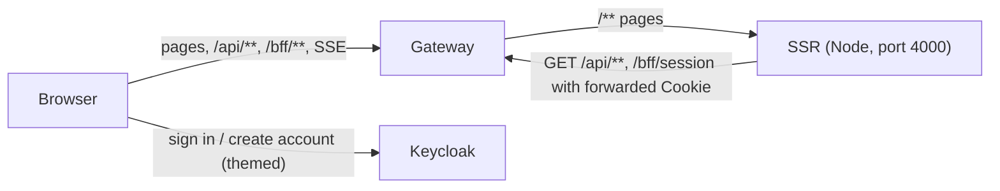

# 04 — Frontend (Angular with SSR)

| | |
| --- | --- |
| **Status** | Draft v0.2 — assumptions marked `F-xx` need confirmation. Screens now follow the UI mock‑ups in `../ui/` (§3.5); UI text ships in zh‑TW, mock‑ups show English placeholder text |
| **Module** | `frontend/` (Angular workspace, application `bookstore-web`) |
| **Depends on** | `00-conventions.md`, `01-gateway.md` (`/bff/*`, CSRF, login/logout), `02-inventory-service.md`, `03-user-service.md`, `05-keycloak.md` (sign‑in / registration theme) |
| **ARCH refs** | §3.1 Angular SSR, §3.2, §4.2, §4.3 (client side), §5 |

**Changes in v0.2 (from the `ui/` mock‑ups)**

- Catalog is a Material table on `/books` with title search and a paginator (page size + "1 – 10 of N"). Home page dropped; `/` redirects to `/books` (F‑12).
- Admins manage books and authors **inline on `/books`** through dialogs (Add New Book, edit/delete per row, Manage Authors). `/admin/books*` and `/admin/authors*` pages removed. Users and audit stay as admin pages.
- Book form gains published date and description; the author field is a dropdown of existing authors.
- Live updates show a snackbar ("新書上架") and refresh the visible page, instead of the "有 N 本新書" banner.
- Account page edits first/last name and address only (layout per mock‑up); success is a snackbar.
- Sign‑in and sign‑up screens are the Keycloak login theme (05 §5.3), not Angular pages.
- App shell: toolbar (menu, brand, sign‑in or account + sign‑out) and footer (copyright, 隱私權政策, 服務條款).
- Pagination switched from keyset "next page" to offset with totals for the catalog (00 §3.3, 02 §3.1).

## 1. Purpose and scope

**Responsibilities**

- Public catalog: book table with search and paging, book detail, author page. Server‑rendered for SEO, first paint and no‑JS reading.
- Account area: view and edit own profile.
- Admin features: book and author management inline in the catalog; user management and audit log pages.
- Live catalog updates via SSE (browser only).
- Session awareness (signed in or not, roles) via the gateway.

**Non‑goals (v1)**

- Cart, checkout, orders.
- Offline support / service worker.
- English UI (strings are prepared for translation, only zh‑TW ships; F‑01).
- Sitemap generation (F‑06).
- Sign‑in, sign‑up and password screens in Angular (they are Keycloak pages, 05 §5.3).

## 2. Context

The browser talks only to `https://shop.bookstore.example` (and to `https://auth.bookstore.example` for sign‑in/registration pages). The Node SSR server talks only to the gateway's in‑cluster Service.



## 3. Interfaces

### 3.1 Technology

| Item | Choice |
| --- | --- |
| Framework | Angular 22, standalone components, signals, zoneless change detection (F‑02) |
| SSR | `@angular/ssr` with the Node/Express server; incremental hydration (`@defer (hydrate on …)`) |
| State | NgRx SignalStore, one store per feature |
| Forms | Typed reactive forms |
| UI kit | Angular Material + CDK (M3 theme, §3.5.1) (F‑03) |
| HTTP | `HttpClient` with `withFetch()` |
| API types | Generated from each service's committed `openapi.yaml` with `openapi-typescript` into `src/app/api/generated/` (types only; hand‑written thin services call `HttpClient`). Regenerated by `npm run api:generate`; CI fails if output differs |
| i18n | Angular built‑in `$localize`; source locale `zh-Hant-TW`. Every user‑visible string is marked |
| Tests | Vitest for unit/component, Playwright for e2e |
| Lint/format | ESLint (angular‑eslint), Prettier |
| File naming | Angular 20+ style guide: no `.component`/`.service` suffixes (`header.ts`, `book-list.ts`, `authentication.ts`); one folder per component with `.ts`, `.html`, `.scss`, `.spec.ts` |

### 3.2 Pages and render modes

Defined in `app.routes.ts` (lazy feature routes such as `features/books/books.routes.ts`) and `app.routes.server.ts` (`ServerRoute[]`).

| Path | Page | Render mode | Access |
| --- | --- | --- | --- |
| `/` | Redirect 301 to `/books` | Server | Public |
| `/books` | Book catalog table. Query params: `q`, `page` (1‑based), `size`, `genre`, `authorId` | Server | Public; admin controls when `isAdmin` |
| `/books/:id` | Book detail (optional trailing `/:slug`, ignored, used for readable URLs) | Server | Public |
| `/authors/:id` | Author bio + their books (same table component) | Server | Public |
| `/account` | My profile form | Client | Signed in (gateway enforces) |
| `/admin/users` | User search table | Client | ADMIN |
| `/admin/users/new`, `/admin/users/:id` | Create user; detail with roles, enable/disable, reset password | Client | ADMIN |
| `/admin/audit` | Audit log viewer (both services, tabbed) | Client | ADMIN |
| `/privacy`, `/terms` | Static 隱私權政策 / 服務條款 (footer and registration links) | Server (prerender) | Public |
| `/forbidden` | 403 page | Server | Public |
| `**` | 404 page (sets HTTP 404 on the SSR response) | Server | Public |

Account and admin pages are client‑rendered: they need no SEO, and it keeps personalised HTML out of SSR. The gateway still blocks them for anonymous/non‑admin users before SSR is reached (01 §6.1). Admin book/author management has no route of its own; it is dialogs opened from `/books`, and every write goes to `/api/admin/catalog/**`, which the gateway restricts to `ADMIN`.

### 3.3 APIs consumed

| Client service | Endpoints |
| --- | --- |
| `Authentication` (`core/services/authentication.ts`) | `GET /bff/session`; builds `/bff/login` URLs; logout form |
| `CatalogApi` | `GET /api/catalog/books`, `/books/{id}`, `/authors/{id}`, `/genres` |
| `CatalogEvents` | `EventSource('/api/catalog/stream')` |
| `ProfileApi` | `GET/PUT /api/users/me` |
| `AdminCatalogApi` | 02 §3.2: book create/update/delete/restore/cover; author list/get/create/update/delete |
| `AdminUsersApi` | All of 03 §3.3 |

### 3.4 Project structure

Follows the folder layout in `../ui/folder-structure-2.png`, extended to all features:

```
src/app/
├── app.ts, app.html, app.config.ts, app.config.server.ts, app.routes.ts, app.routes.server.ts
├── api/generated/                    # openapi-typescript output (do not edit)
├── core/
│   ├── services/authentication.ts    # session state (signals), login URL, logout
│   ├── services/catalog-events.ts    # SSE client (browser only)
│   ├── interceptors/                 # server-api.ts (SSR), auth-errors.ts (401 handling)
│   └── guards/                       # signed-in.ts, admin.ts (canMatch)
├── features/
│   ├── books/
│   │   ├── books.routes.ts
│   │   ├── pages/list/               # /books: header bar, search, table, paginator
│   │   ├── pages/detail/             # /books/:id
│   │   ├── components/book-list/     # mat-table of books (+ admin actions column)
│   │   ├── components/book-form-dialog/
│   │   ├── components/authors-dialog/      # "Manage Authors"
│   │   ├── components/author-form-dialog/
│   │   └── data/                     # catalog-api.ts, admin-catalog-api.ts, catalog-list.store.ts, book-detail.store.ts
│   ├── authors/pages/detail/
│   ├── account/pages/profile/        # + profile.store.ts, profile-api.ts
│   ├── admin/users/…, admin/audit/…
│   └── legal/pages/{privacy,terms}/
└── shared/
    ├── layout/header/, layout/footer/, layout/sidenav/
    ├── ui/confirm-dialog/, ui/page-hero/          # gradient title band used by account page
    └── util/                         # isbn.ts, price.ts, genre-labels.ts, country.ts
```

### 3.5 Screen designs

Mock‑ups live in `../ui/`. They show English placeholder copy and a placeholder brand; the shipped UI uses the zh‑TW strings below and the brand name from i18n (`品牌名稱`, default "Bookstore 書店").

#### 3.5.1 Visual language

- Angular Material M3 theme, primary palette indigo (`#3f51b5` toolbar/footer, primary buttons), error palette red for delete icons, neutral surfaces. Roboto + Noto Sans TC.
- Hero background for form pages (account, Keycloak pages): linear gradient 135° from `#667eea` to `#764ba2`, white title (display‑small) and subtitle, content in a white elevated card (radius 8 px, max width 480 px for sign‑in, 560 px for profile/registration).
- Outlined form fields; required fields marked `*`; primary action is a full‑width raised button, disabled until the form is valid.
- Feedback via `MatSnackBar` at bottom centre, 4 s, one action (`關閉` or `略過`).

#### 3.5.2 App shell (`shared/layout`) — `app-header-signin-button.png`

| Area | Anonymous | Signed in | Admin |
| --- | --- | --- | --- |
| Toolbar left | Menu icon (opens sidenav), brand (link to `/books`) | same | same |
| Toolbar right | `login` icon + 登入 → `/bff/login?returnTo=<current>` | `person` icon button → `/account`, `logout` icon + 登出 (POST form, §5.3) | same |
| Sidenav | 書籍目錄 | + 我的帳戶 | + 使用者管理, 稽核紀錄 |
| Footer | `© <year> <brand>` left; 隱私權政策, 服務條款 right | same | same |

The toolbar and footer are fixed; the content area scrolls between them.

#### 3.5.3 Book catalog `/books` — `book-page-logged-in-and-anonymous-users.png`, `books-page-javascript-disabled.png`

- Page header: title 書籍目錄. Admins also see an outlined `group` 作者 button (opens Manage Authors, §5.7) and a raised `add` 新增書籍 button (opens the book form, §5.6).
- Full‑width search field 依書名或作者搜尋 bound to `q`.
- `mat-table` columns: 書名 (link to `/books/:id`), 作者 (names joined with `、`), 類型 (zh label, 00 §12), 價格, 出版日期 (`yyyy-MM-dd`), and for admins 操作 (`edit` icon in primary, `delete` icon in red, each with `aria-label` and tooltip).
- `mat-paginator` below the table: page sizes 10 / 20 / 50 (default 10), range label "1 – 10，共 N 筆", previous/next buttons.
- Without JavaScript (SSR HTML only) the table, title links, search (plain `<form method="get" action="/books">`) and paging (`<noscript>` with real `<a href>` previous/next links) all work; admin controls render but do nothing until hydration, so they are wrapped in `@defer (hydrate on interaction)`.
- Row states: deleted via SSE → row greyed with chip 已下架; price changed → price cell highlight.
- Empty state: 找不到符合的書籍 with a 清除搜尋 link. Error state: panel with 重試.

#### 3.5.4 Book form dialog — `book-form-dialog-from-book-list.png`, `book-form-dynamic-author-dropdown.png`

`MatDialog`, width 640 px (full screen below 600 px), scrollable content, sticky actions. Title 新增書籍 / 編輯書籍.

| Field | Control | Required |
| --- | --- | --- |
| 書名 | text, placeholder 請輸入書名, autofocus | yes |
| ISBN | text | yes |
| 作者 | `mat-select` `multiple` of existing authors (loaded when the dialog opens); selected names shown joined with `、`; at least one (F‑13) | yes |
| 價格 (NT$) | number‑like text, half width | yes |
| 類型 | `mat-select` of Genre labels, half width | yes |
| 出版日期 | `matDatepicker` (`yyyy-MM-dd`) | yes |
| 簡介 | textarea, label suffix (選填) | no |
| 頁數 | integer, half width (選填) | no |
| 庫存數量 | integer, half width, default 0 | yes |
| 封面 | upload control, edit mode only (§5.6) | no |

Actions: 取消 (text button), 建立書籍 / 儲存變更 (raised, disabled while invalid or saving). On success the dialog closes and a snackbar shows 書籍已建立 / 書籍已更新 with 關閉.

#### 3.5.5 Manage Authors dialog — `author-dialog.png`

Title 作者管理. Search field 依姓名搜尋 (debounced 250 ms). Table columns 姓名, 國籍 (`Intl.DisplayNames('zh-TW', { type: 'region' })` of the ISO code), 書籍數, 操作 (edit, delete). Paginator (10 per page). Actions: 關閉 and raised `add` 新增作者. Edit/新增 open the author form dialog (姓名 required, 國籍 select of ISO countries, 簡介 textarea).

#### 3.5.6 Real‑time notification — `real-time-toast-notification.png`

Any viewer of `/books` (anonymous or signed in) gets a snackbar 新書上架：《<title>》 with 略過, and the visible page refreshes (§5.5). The admin who created the book sees only 書籍已建立 (their own event is not toasted).

#### 3.5.7 My profile `/account` — `profile-page-update-header-snack-bar.png`

Hero title 我的個人資料, subtitle 管理您的帳戶資料. Card with a two‑column grid (one column below 600 px):

| Row | Left | Right |
| --- | --- | --- |
| 1 | 名 * | 姓 * |
| 2 | 地址 (full width) | |
| 3 | 縣市 (select of 22 when country is TW, else text) | 鄉鎮市區 |
| 4 | 郵遞區號 | 國家 (select, default 台灣) |

Full‑width raised 儲存變更. Success → snackbar 個人資料已更新 with 關閉. Email is shown read‑only under the title with a link 變更 Email 或密碼 → `accountConsoleUrl`.

#### 3.5.8 Sign in / Create account — `signin.png`, `signup.png`

Implemented in the Keycloak login theme, see 05 §5.3. The app's only part is the 登入 button that starts `/bff/login`.

## 4. Data model (client state)

| Store | State | Notes |
| --- | --- | --- |
| `Authentication` | `status: 'unknown'|'anonymous'|'authenticated'`, `user`, `roles`, computed `isAdmin` | Loaded once at app start (server and browser) |
| `CatalogListStore` | `query` (`q`, `page`, `size`, `genre`, `authorId` from URL), `items: BookView[]`, `total`, `loading`, `error`, `ownCreatedIds: Set<string>` | Source of truth is the URL; store derives from it |
| `BookDetailStore` | `book`, `loading`, `error`, `removed: boolean` | |
| `ProfileStore` | `me`, `etag`, `saving`, `error` | |
| `AuthorsDialogStore` | `q`, `page`, `items: AuthorView[]`, `total`, `loading` | Lives with the dialog instance |
| Admin user/audit stores | per page: list state, form state | Not shared with public stores |

`ETag` values from responses are kept with the entity and sent back as `If-Match`. For rows in the catalog table the book's `version` from `BookView` is the ETag value (00 §3.4).

## 5. Behaviour and flows

### 5.1 SSR data flow

- `provideClientHydration(withIncrementalHydration(), withHttpTransferCacheOptions({ includePostRequests: false, filter: req => req.url.includes('/api/catalog/') || req.url.endsWith('/bff/session') }))` so catalog data and the session state fetched on the server are reused on hydration (ARCH §4.2).
- Server‑only `HttpInterceptor` (registered in `app.config.server.ts`):
  - rewrites relative URLs `/api/...` and `/bff/...` to `${GATEWAY_INTERNAL_URL}/api/...`;
  - copies the incoming request's `Cookie` header (from the `REQUEST` injection token) onto the outgoing request;
  - sets `X-Forwarded-Host` and `X-Forwarded-Proto` from the incoming request so the gateway computes correct absolute URLs;
  - timeout 3 s per API call.
- If the catalog API fails during SSR, render the page shell with an error state and HTTP status 503 for list pages, 404 when the API returned 404. Never let SSR hang.
- SSR response headers: pages rendered while a `SESSION` cookie was present get `Cache-Control: private, no-store`; anonymous public pages get `Cache-Control: public, max-age=0, must-revalidate`.
- SEO per page: `<title>`, `meta description`, canonical URL (`/books/:id` without slug or query; `/books` with only `genre` and `page` > 1), Open Graph tags, and on book detail JSON‑LD `Book` (`name`, `isbn`, `author`, `datePublished`, `description`, `image`, `offers.price`, `offers.priceCurrency`, `offers.availability`).
- `/books` paging for crawlers and no‑JS: `<link rel="prev/next">` in the head and `<noscript>` anchor links (§3.5.3).

### 5.2 Catalog list

- URL is the state: search and paging update query params (`router.navigate` with `queryParamsHandling: 'merge'`); a new search resets `page`. The store reacts to `ActivatedRoute.queryParamMap`.
- API call: `GET /api/catalog/books?q=&genre=&authorId=&sort=…&offset=(page-1)*size&limit=size`. Sort: `TITLE_ASC` when no `q` (matches the alphabetical mock‑ups), `RELEVANCE` when `q` is set. No sort control in v1 (F‑14).
- Search box: debounced 300 ms, max 100 chars; Enter submits immediately; clearing it removes `q`.
- Paginator: `length = total`, `pageIndex = page - 1`, `pageSize = size`; changing size resets to page 1. `page` beyond the last page → API returns empty `items` with `total`; the page then navigates to the last page.
- Prices formatted with `Intl.NumberFormat('zh-TW', { style: 'currency', currency: 'TWD', minimumFractionDigits: 0 })` from the string value (never parse to float for arithmetic; display only).
- Dates: `publishedDate` is a plain `yyyy-MM-dd` string; display as is (no time‑zone conversion).
- The table has no cover column; covers appear on the detail page (`NgOptimizedImage`, placeholder SVG on `error`).

### 5.3 Session and login

- `Authentication.load()` runs in `provideAppInitializer` on both server and browser; the transfer cache prevents a second call on hydration.
- 登入 button: full page navigation to `/bff/login?returnTo=<current path + query>`. Not a router link. Keycloak shows the themed sign‑in page; its 立即註冊 link leads to the themed registration page, and both return to `returnTo` after success.
- 登出: a real `<form method="post" action="/logout">` with a hidden `_csrf` input whose value is read from the `XSRF-TOKEN` cookie at submit time.
- HTTP interceptor (browser): on 401 from `/api/**`, set session to anonymous; if the current route needs auth, `window.location.assign('/bff/login?returnTo=…')`. On 401 with code `session-expired`, show a snackbar 登入已逾時 before redirecting.
- Route guards (`canMatch`) on `/account` and `/admin/**` check `Authentication` and redirect client‑side; they only shape the UI (ARCH §3.2). Admin controls on `/books` and admin sidenav items are hidden unless `isAdmin`.
- CSRF: `withXsrfConfiguration({ cookieName: 'XSRF-TOKEN', headerName: 'X-XSRF-TOKEN' })` adds the header to same‑origin mutating requests automatically. Absolute URLs disable it, so browser code always uses relative URLs.

### 5.4 Account page

- Loads `GET /api/users/me`; fills 名/姓 from `firstName`/`lastName` and the address block from `profile.address` (`line1` → 地址, `city` → 縣市, `district` → 鄉鎮市區, `postalCode` → 郵遞區號, `country` → 國家).
- Address is all‑or‑nothing: if any address field is filled, 地址, 縣市, 郵遞區號 and 國家 become required; all empty → `address: null`. Validation mirrors 03 §3.2.
- When country is `TW`, 縣市 is a select of the 22 municipalities/counties and 鄉鎮市區 free text (F‑07).
- Save: `PUT /api/users/me` with `If-Match`, sending `firstName`, `lastName`, `address`, and the unchanged `displayName`, `phone`, `preferences` from the loaded state (these fields are not shown in v1, F‑15). On 412: dialog 資料已在其他地方更新 with 重新載入 (no merge).

### 5.5 Live updates (SSE)

`CatalogEvents` — browser only (create it inside `afterNextRender` or guard with `isPlatformBrowser`; never on the server):

- One `EventSource('/api/catalog/stream')` per tab, opened when a catalog page is active, closed when the user navigates to account/admin areas.
- Handles named events `ready`, `book.created`, `book.updated`, `book.price-changed`, `book.deleted`.
- Dedupe by `eventId` (last 500) and ignore events whose `aggregateVersion` ≤ the version held for that book.
- Effects:
  - `book.created` → unless `bookId` is in `ownCreatedIds`, show snackbar 新書上架：《title》 (略過). If the book matches the current query, refetch the current page (debounced 1 s, so a burst causes one fetch). Several events within 5 s collapse into one snackbar 新書上架：N 本.
  - `book.updated` → replace the row / detail in place. If it no longer matches the current query, keep it until the next navigation (avoids rows jumping).
  - `book.price-changed` → update price if shown; briefly highlight the cell (CSS animation, respects `prefers-reduced-motion`).
  - `book.deleted` → on the list, grey out the row with chip 已下架; on detail, show a banner and disable interactions.
- Reconnect: `EventSource` reconnects automatically (server sends `retry: 3000`). After an `error` followed by `ready`, refetch the current list page or detail (missed events are not replayed, 02 §5.6).
- When `document.visibilityState` is `hidden` for more than 5 minutes, close the stream; reopen and refetch on `visible` (F‑05).

### 5.6 Admin book form (dialog)

- Opened from 新增書籍 (create) or a row's edit icon (edit loads `GET /api/admin/catalog/books/{id}` for the full `AdminBookView` and its ETag).
- Fields per 02 §3.2 `BookWrite`. Client‑side validators mirror server rules, including the ISBN‑10/13 check digit and `publishedDate` not in the future.
- 作者 options: `GET /api/admin/catalog/authors?limit=100&offset=0` sorted by name when the dialog opens; selected order = `authorIds` order (= `position`). More than 100 authors → switch the control to an autocomplete (F‑13).
- Price input accepts digits and one decimal point, sent as a string with 2 decimals.
- Cover: section at the bottom of the dialog in edit mode only (create first, then edit to upload). Accept `image/jpeg,image/png,image/webp`, check ≤ 5 MB client‑side, show preview, upload with `If-Match`, update the stored ETag from the response.
- Save: POST (create; add the returned id to `ownCreatedIds`) or PUT with `If-Match`. Server validation errors (`errors[]`) map onto form controls by `field`; unknown fields show in a form‑level error box at the top of the dialog. 409 `isbn-taken` maps to the ISBN control.
- 412 handling: nested dialog offering 重新載入 (discard local changes) or 查看差異 (side‑by‑side of server vs local values, then reload). No automatic merge.
- Delete (row icon): confirm dialog 確定要下架《title》？ → `DELETE` with `If-Match: "<row version>"`. Success → row removed by refetch and snackbar 已下架《title》 with action 復原 (8 s), which calls `GET` admin book (for the new ETag) then `POST …/restore`. 412 → snackbar 資料已變更，請重新整理 and refetch.
- Restoring older soft‑deleted books has no UI in v1 (F‑16).

### 5.7 Manage Authors (dialog)

- List: `GET /api/admin/catalog/authors?q=&offset=&limit=10` → `AuthorView` with `bookCount`; paginator uses `total`.
- Create/edit in the author form dialog: POST, or PUT with `If-Match` (edit loads the author first for its ETag). Snackbar 作者已新增 / 作者已更新. A new author created here appears in the book form's author select the next time it opens.
- Delete: confirm, then `DELETE` with `If-Match`. 409 `author-in-use` → snackbar 此作者仍有書籍，無法刪除. Delete icon is disabled with a tooltip when `bookCount > 0`.
- Author changes are not pushed over SSE (02 §1); after closing the dialog the catalog page refetches so renamed authors show.

### 5.8 Admin users

- Search table with offset paging (03 §3.3), same table/paginator styling as the catalog.
- Create form: email, 名, 姓, roles (USER fixed on, ADMIN checkbox), 寄送邀請信 (default on). Show `inviteSent: false` result as a warning.
- Detail: roles editor (ADMIN toggle), enable/disable switch, 寄送重設密碼信 button. Disable own account / remove own admin is prevented in the UI and by the server (409 messages displayed as is).
- 刪除帳戶 (delete account, on a customer's request, [ADR 0014](../adr/261020-add-admin-run-account-deletion.md)): confirm dialog that requires typing the user's email; `DELETE /api/admin/users/{id}`; on 204 navigate back to the list with snackbar 帳戶已刪除.

### 5.9 Audit viewer

Two tabs (書籍目錄, 使用者). Filters: entity ID, actor, date range. Each row expands to show `changes` as a field/old/new table. User‑service rows pair intent and outcome records by `correlationId` and show the outcome (成功 / 失敗 / 結果未確認); user email and name are looked up live by `entityId`, deleted users show as 已刪除的使用者 ([ADR 0016](../adr/261020-use-pending-then-confirm-user-audit.md), [ADR 0015](../adr/261020-keep-pii-out-of-user-audit-records.md)).

## 6. Security

- No tokens in the browser; all auth via the `SESSION` cookie (HttpOnly) and the gateway. Passwords are entered only on Keycloak pages.
- Never use `bypassSecurityTrust*`. No `innerHTML` with server data (author bios and book descriptions are plain text rendered with `white-space: pre-line`).
- Admin controls on `/books` are UI only; the gateway and inventory enforce `ADMIN` on every `/api/admin/**` call.
- CSP nonce: configure Angular's `ngCspNonce`/`CSP_NONCE` so the inline event‑replay script carries a nonce. The Express server generates a random nonce per request and sets the `Content-Security-Policy-Report-Only` header itself for HTML responses (the gateway leaves an existing CSP header alone, 01 §5.7). Use the same policy as 01 §5.7 plus `'nonce-…'` in `script-src`.
- Express server: disable `x-powered-by`; serve static assets from `dist/browser` with `Cache-Control: public, max-age=31536000, immutable` for hashed files and `no-cache` for `index.csr.html`.
- `returnTo` values are always relative paths built by the app.

## 7. Configuration

Runtime configuration for the SSR server (env vars). The browser bundle needs no environment‑specific values (everything is same‑origin), so one build artefact serves all environments.

| Env var | Required | Default | Purpose |
| --- | --- | --- | --- |
| `PORT` | no | 4000 | |
| `GATEWAY_INTERNAL_URL` | yes | — | `http://gateway.bookstore-app.svc:8080` |
| `PUBLIC_BASE_URL` | yes | — | `https://shop.bookstore.example`; canonical and Open Graph URLs |
| `SSR_API_TIMEOUT_MS` | no | 3000 | |
| `OTEL_*` | no | — | Optional, see §9 |

## 8. Deployment

- Dockerfile: build stage `node:24` runs `npm ci && npm run build`; runtime `node:24-slim` (or distroless node) runs `node dist/server/server.mjs` as non‑root UID 10001.
- Chart `platform/charts/web`. Service `web` port 4000. 2–6 replicas, HPA on CPU 70 %. Requests 200m / 256Mi, limits 1 CPU / 512Mi.
- Health: `GET /healthz` (Express route, returns 200 without rendering) for liveness and readiness.
- NetworkPolicy: ingress from gateway only; egress to gateway and OTel collector.

## 9. Observability

- Express middleware logs one JSON line per request (method, path without query string, status, duration ms, render mode). No cookies, no query strings (they may contain search terms; F‑08).
- `prom-client` metrics at `/metrics` on port 9464 (separate listener): render duration histogram by route pattern, API call duration by endpoint, SSR errors counter, Node default metrics.
- OpenTelemetry for Node (`@opentelemetry/sdk-node` with HTTP/Express auto‑instrumentation) so SSR → gateway calls join traces (F‑09).
- Browser: report `window.onerror` and unhandled rejections to the console only in v1 (no RUM service).

## 10. Failure modes

| Failure | Behaviour |
| --- | --- |
| Inventory down during SSR | List page renders with an error panel and 503; detail page 503 with retry link |
| Gateway session store down | `/bff/session` fails → treat as anonymous, show a non‑blocking snackbar |
| SSE unavailable | Pages work without live updates; `EventSource` keeps retrying every 3 s |
| Cover image fails to load | Placeholder image |
| JS fails to hydrate / disabled | Table, links, search form and `<noscript>` paging work from server HTML (`books-page-javascript-disabled.png`) |
| Admin write fails (5xx) | Dialog stays open with a form‑level error; nothing is lost |

## 11. Testing

- Unit (Vitest): stores (event handling with version checks, dedupe, own‑event suppression), ISBN validator, address all‑or‑nothing validator, URL ↔ paging state mapping, interceptors.
- Component tests: book list renders from fixtures with and without admin column; book form dialog maps server `errors[]` to controls; authors dialog disables delete when `bookCount > 0`; header shows 登入 vs account/登出 by session.
- SSR tests: render `/books?q=dune` on the server with a mocked gateway; assert HTML contains rows, title links, canonical link, `<noscript>` paging links, transfer state present, and no `EventSource` constructed; `/` returns 301 to `/books`.
- Playwright e2e (against the full stack in kind or docker compose):
  1. Anonymous browse, search, change page size, next page, open detail; same with JavaScript disabled.
  2. Sign in on the themed Keycloak page, edit first name and address, save, snackbar shown, reload shows changes; conflict dialog when edited in a second tab.
  3. Register a new account on the themed page (terms checkbox required) and land back on `/books` signed in.
  4. Admin opens Manage Authors, adds an author, creates a book with it; a second (anonymous) browser on `/books` sees the 新書上架 snackbar and the new row; the admin sees only 書籍已建立. Price change shows without reload.
  5. Admin deletes a book and restores it from the snackbar.
  6. Non‑admin sees no admin controls on `/books`; visiting `/admin/users` lands on `/forbidden`.
  7. Sign out returns to `/books` anonymous.
- Visual regression: Playwright screenshots of the screens in §3.5 compared against approved baselines.
- Accessibility: `@axe-core/playwright` on list, detail, account, book form dialog, authors dialog; no serious violations. Icon buttons have `aria-label`s.
- Performance budget: initial JS for public routes ≤ 250 kB compressed; LCP on `/books` ≤ 2.5 s on a mid‑range mobile profile (Lighthouse CI, F‑10).

## 12. Implementation plan

1. Workspace, SSR, Material theme, i18n setup, Express server with `/healthz`, server interceptor, API type generation.
2. App shell: header, sidenav, footer; `Authentication`, sign‑in/out, guards, 401 handling.
3. Catalog table (search, paginator, offset paging) with SSR + transfer cache + SEO tags + no‑JS paging.
4. Book detail and author pages with JSON‑LD; `/privacy`, `/terms`.
5. SSE service, store integration and snackbars.
6. Account page.
7. Admin dialogs: Manage Authors, then book form (with cover upload, delete/restore, conflict handling).
8. Admin users and audit viewer.
9. CSP nonce, metrics, tracing, Playwright suite (incl. visual baselines), chart.

## 13. Assumptions to confirm

| ID | Assumption | If wrong |
| --- | --- | --- |
| F‑01 | zh‑TW only in v1 (mock‑ups' English copy is placeholder), strings marked for i18n | Add `en` build and locale routing (`/en/...`) in gateway and SSR |
| F‑02 | Zoneless change detection | Add `zone.js` back; no other changes |
| F‑03 | Angular Material (M3, indigo) as UI kit, per mock‑ups | Swap for your design system; screens in §3.5 stay the same |
| F‑04 | **Decided 2026‑10‑20 — [ADR 0002](../adr/261020-use-offset-paging-for-catalog-tables.md).** Offset paging with totals for the catalog (paginator in mock‑ups) | Keyset "next page" only: drop totals and page‑size control |
| F‑05 | Close SSE after 5 min in a hidden tab | Keep it open; costs one connection per idle tab |
| F‑06 | No sitemap in v1 | Add `/sitemap.xml` Express route walking the catalog API |
| F‑07 | TW county/city list in the frontend; no district list | Add full district data |
| F‑08 | Search terms are not logged by SSR | Log them if you want search analytics (consider privacy) |
| F‑09 | SSR has OpenTelemetry tracing | Drop it; traces then start at the gateway |
| F‑10 | Performance budgets in §11 | Set your own |
| F‑11 | Admin UI lives in the same app as the storefront | Separate app means a separate SSR/static deployment and gateway route |
| F‑12 | No home page; `/` redirects to `/books` (mock‑ups show no home) | Restore a home page with new arrivals and genre tiles |
| F‑13 | **Confirmed 2026‑10‑20.** Author field is a multi‑select dropdown (several authors per book, 1–20, order = selection order) of up to 100 authors | Large author lists: switch to an autocomplete |
| F‑14 | No sort control; title order without search, relevance with search | Add sortable column headers (`matSort`) mapped to `sort` |
| F‑15 | **Confirmed 2026‑10‑20.** Profile page hides `displayName`, `phone`, favourite genres and newsletter (not in mock‑up) | Add a second card with these fields |
| F‑16 | **Confirmed 2026‑10‑20.** Restore only via the snackbar right after delete | Add an admin "已下架" filter using `includeDeleted` |
| F‑17 | **Confirmed 2026‑10‑20.** Mock‑up brand and copyright are placeholders; brand comes from i18n (`品牌名稱`, default "Bookstore 書店"), so the final name is a one‑string change | — |
