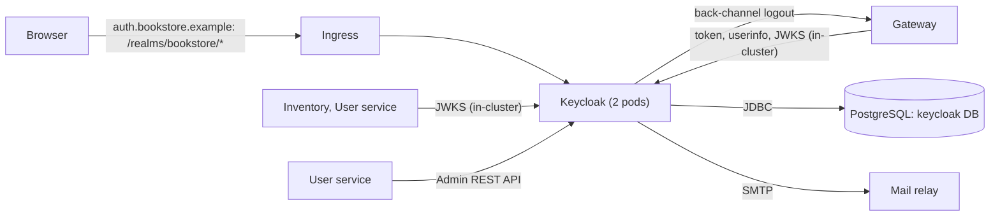

# 05 — Keycloak (identity)

| | |
| --- | --- |
| **Status** | Draft v0.2 — assumptions marked `K-xx` need confirmation. v0.2: sign‑in and registration screens per UI mock‑ups `../ui/signin.png`, `../ui/signup.png` (remember me, terms checkbox, optional address) |
| **Module** | `identity/keycloak/` (realm config, theme), `platform/charts/keycloak` (Keycloak CR, ingress, config job) |
| **Depends on** | `00-conventions.md`, `06-data-platform.md` (PostgreSQL `keycloak` database) |
| **ARCH refs** | §3.1, §4.1, §6.1, §6.2 |

## 1. Purpose and scope

**Responsibilities**

- Realm `bookstore`: registration, login, credentials, email verification, password reset.
- Realm roles `USER` and `ADMIN`.
- OIDC clients for the gateway (user login) and the user service (Admin API).
- Login and account pages themed for the bookstore, zh‑TW first.
- Realm configuration kept as code and applied by GitOps.

**Non‑goals (v1)**

- Social login, MFA requirement, passkeys (K‑05).
- Fine‑grained admin permissions.
- Exposing the Keycloak admin console publicly.

## 2. Context



## 3. Interfaces (realm configuration)

All of the following is declared in `identity/keycloak/realm/bookstore.yaml` and applied with **keycloak-config-cli** (§5.2).

### 3.1 Realm settings

| Setting | Value |
| --- | --- |
| Realm | `bookstore`, display name "Bookstore" |
| `registrationAllowed` | true |
| `registrationEmailAsUsername` | true |
| `loginWithEmailAllowed` | true |
| `duplicateEmailsAllowed` | false |
| `verifyEmail` | true (K‑01) |
| `resetPasswordAllowed` | true |
| `rememberMe` | true (sign‑in mock‑up; K‑09) |
| `editUsernameAllowed` | false |
| `bruteForceProtected` | true; `failureFactor` 5, `waitIncrementSeconds` 60, `maxFailureWaitSeconds` 900, `maxDeltaTimeSeconds` 43200 |
| Password policy | `length(12) and notUsername and notEmail and passwordHistory(3)` (K‑02) |
| `sslRequired` | `external` |
| Internationalisation | enabled; `supportedLocales` [`zh-TW`, `en`]; `defaultLocale` `zh-TW` |
| Themes | `loginTheme` `bookstore`, `accountTheme` default (`keycloak.v3`), `emailTheme` `bookstore` |
| SMTP | host/port/from from env (§7); `starttls` true; auth with secret credentials |
| Events | user events enabled, types: `LOGIN`, `LOGIN_ERROR`, `REGISTER`, `LOGOUT`, `UPDATE_PASSWORD`, `VERIFY_EMAIL`, `SEND_RESET_PASSWORD`; expiration 30 days. Admin events enabled with representation, expiration 90 days |

### 3.2 Roles and clients

**Realm roles:** `USER`, `ADMIN`. The realm's default role composite `default-roles-bookstore` includes `USER`, so every registered user gets it.

**Client `bookstore-gateway`** (user login)

| Setting | Value |
| --- | --- |
| Type | OpenID Connect, confidential (`publicClient: false`, client authenticator `client-secret`) |
| Flows | Standard flow on; implicit off; direct access grants off; service accounts off; device grant off |
| PKCE | attribute `pkce.code.challenge.method` = `S256` |
| Redirect URIs | `https://shop.bookstore.example/login/oauth2/code/keycloak` (exact, no wildcards) |
| Post‑logout redirect URIs | `https://shop.bookstore.example/` |
| Web origins | `https://shop.bookstore.example` |
| Front‑channel logout | off |
| Back‑channel logout URL | `http://gateway.bookstore-app.svc:8080/logout/connect/back-channel/keycloak` |
| Back‑channel logout session required | on (logout token carries `sid`) |
| Consent | off |
| Default client scopes | `openid`, `profile`, `email`, `roles`, `web-origins`, `bookstore-api-audience` |
| Optional client scopes | none (remove `offline_access`, `address`, `phone`, `microprofile-jwt`) |

Local/dev overlays add `http://localhost:8080/login/oauth2/code/keycloak` and its post‑logout URI only in the dev realm file, never in production config.

**Client `bookstore-user-service`** (Admin API)

| Setting | Value |
| --- | --- |
| Type | OpenID Connect, confidential |
| Flows | Service accounts only; standard flow off; direct access grants off |
| Service account roles | client `realm-management`: `view-users`, `query-users`, `manage-users` (K‑03) |
| Default client scopes | `roles` only |

### 3.3 Client scope `bookstore-api-audience` and mappers

| Mapper | Type | Config |
| --- | --- | --- |
| `audience-bookstore-api` | Audience | Included custom audience `bookstore-api`; add to access token: on; add to ID token: off |

On the built‑in `roles` client scope, the **realm roles** mapper (`realm_access.roles`): set *Add to ID token* **on** (the gateway reads roles from the ID token, 01 §5.1), *Add to access token* on, *Add to userinfo* on.

Keep the built‑in `profile` and `email` scopes (claims `preferred_username`, `name`, `given_name`, `family_name`, `email`, `email_verified`).

### 3.4 Sessions and tokens

| Setting | Value | Constraint |
| --- | --- | --- |
| SSO Session Idle | 30 min | ≥ gateway `SESSION_TIMEOUT` (01 §5.5) |
| SSO Session Max | 10 h | |
| SSO Session Idle / Max Remember Me | 7 days / 30 days | Applies only when 記住我 is ticked. The gateway session still idles out after 30 min; the next `/bff/login` then completes silently from the Keycloak SSO cookie (01 §5.5) |
| Access token lifespan | 5 min | |
| Refresh token rotation (`revokeRefreshToken`) | off | Gateway relies on this (01 §5.2) |
| Client session idle/max | inherit realm | |
| Offline sessions | not used | |
| Action token lifespan (admin‑initiated) | 72 h | Matches invite email (03 §5.3) |
| Signature algorithm | RS256 (default) | |

### 3.5 Registration form and user profile

The registration page (`signup.png`) collects: 名 *, 姓 *, Email *, 密碼 *, 確認密碼 *, an optional address block (地址, 縣市, 鄉鎮市區, 郵遞區號, 國家) and a required 我同意服務條款與隱私權政策 checkbox.

Declarative user profile (`userProfile` in realm YAML):

| Attribute | Required | Validators | Permissions | Group |
| --- | --- | --- | --- | --- |
| `email`, `firstName`, `lastName` | yes | built‑in (`length` max 100 for names) | view/edit: admin, user | — |
| `reg_address_line1` | no | `length` max 200 | view/edit: admin, user | `registration-address` |
| `reg_address_city`, `reg_address_district` | no | `length` max 100 | same | same |
| `reg_address_postal_code` | no | `pattern` `^[A-Za-z0-9 \-]{2,10}$` | same | same |
| `reg_address_country` | no | `options` ISO 3166‑1 alpha‑2 list, default `TW` | same | same |

- The user service validates the full address rules (03 §3.2) when it moves these attributes into the profile and then deletes them (03 §5.1). They exist in Keycloak only between registration and the first app visit.
- The account theme hides the `registration-address` group (CSS/`account` theme override), so the Account Console never shows it.
- `unmanagedAttributePolicy`: not set (unmanaged attributes disabled).
- Registration flow: copy the built‑in `registration` flow to `bookstore registration` and add the **Terms and conditions** form action to the registration form as `REQUIRED` (it renders the checkbox and records acceptance on the user). Bind it as the realm's registration flow. Verify the provider name on the Keycloak version you deploy (K‑10).

## 4. Data model

Keycloak's own schema in database `keycloak` (06 §3). Keycloak runs its own migrations on startup; nothing else touches that database.

User data stored in Keycloak: username (= email), email, first/last name, credentials, role mappings, required actions, terms acceptance. Custom attributes: only the transient `reg_address_*` set (§3.5).

## 5. Behaviour and flows

### 5.1 Deployment via the Keycloak Operator

`Keycloak` CR in namespace `identity` (essentials):

```yaml
apiVersion: k8s.keycloak.org/v2alpha1
kind: Keycloak
metadata: { name: keycloak, namespace: identity }
spec:
  instances: 2
  image: <registry>/bookstore-keycloak:<tag>      # custom image with the theme, §5.3
  db:
    vendor: postgres
    host: pg-main-rw.bookstore-data.svc
    database: keycloak
    usernameSecret: { name: keycloak-db, key: username }
    passwordSecret: { name: keycloak-db, key: password }
  hostname:
    hostname: https://auth.bookstore.example
    backchannelDynamic: true          # in-cluster callers use the internal URL for back-channel endpoints
  http:
    httpEnabled: true                 # TLS terminates at the ingress
  proxy:
    headers: xforwarded
  ingress:
    enabled: false                    # we manage the Ingress ourselves, §5.4
  features:
    enabled: []
  additionalOptions:
    - { name: metrics-enabled, value: "true" }
    - { name: health-enabled, value: "true" }
    - { name: event-metrics-user-enabled, value: "true" }
    - { name: cache, value: ispn }    # embedded Infinispan clustering between the 2 pods
  resources:
    requests: { cpu: 500m, memory: 1Gi }
    limits:   { cpu: "2",  memory: 1500Mi }
```

Check option names against the Keycloak version you deploy; they change between major versions.

**Issuer consistency (ARCH §4.1):** the `iss` claim is always `https://auth.bookstore.example/realms/bookstore`, because `hostname` is the full public URL. With `backchannelDynamic`, services can reach token and JWKS endpoints at `http://keycloak-service.identity.svc:8080/realms/bookstore/...` while still receiving the public `iss`.

### 5.2 Realm as code

The Keycloak Operator's `KeycloakRealmImport` only creates a realm that does not yet exist; it does not update one. Use **keycloak-config-cli** (adorsys) instead (K‑04):

- Image pinned to the version that matches your Keycloak major version.
- Runs as a Kubernetes `Job` with Argo CD hook `PostSync` and `hook-delete-policy: BeforeHookCreation`, after Keycloak is ready.
- Authenticates with a dedicated bootstrap admin (from a Secret) on the internal URL.
- `import.managed.*` set to `full` for clients, roles, client scopes and mappers in `bookstore` realm, so removing something from YAML removes it from Keycloak. Users are never managed by config (`import.managed.user: no-delete`).
- Variable substitution on (`import.var-substitution.enabled=true`) for host names, client secrets and SMTP credentials; values come from env, populated from Secrets.

Files:

```
identity/keycloak/
├── realm/bookstore.yaml           # the realm, with $(env:...) placeholders
├── realm/overlays/dev.yaml        # localhost redirect URIs, shorter token lifetimes for tests
├── themes/bookstore/              # login + email theme
├── Dockerfile                     # FROM quay.io/keycloak/keycloak:<ver>; COPY themes; RUN kc.sh build
└── export/bookstore-realm.json    # generated, used by Testcontainers (§11)
```

Client secrets: generated once, stored in Vault (AWS: Secrets Manager), synced by ESO into two Secrets: one for keycloak-config-cli (sets the secret on the client) and one for the consuming app (gateway / user service).

### 5.3 Theme

- Login theme `bookstore` extends `base` with its own `template.ftl` and CSS, so the pages match the app's Material look (04 §3.5.1) rather than PatternFly. Messages in `messages_zh_TW.properties` and `messages_en.properties`.
- Layout (`app-header-signin-button.png`): the app's indigo toolbar (brand linking to `https://shop.bookstore.example/books`, 登入 on the right, no menu), gradient hero with title and subtitle, white card, the app's footer (`© <year> <brand>`, 隱私權政策 and 服務條款 linking to `/privacy` and `/terms` on the shop host). Fonts and CSS are served from the theme (`/resources/`), not from the shop host, so the CSP of each host stays self‑contained.
- Pages:

| Template | Mock‑up | Content |
| --- | --- | --- |
| `login.ftl` | `signin.png` | Hero 登入 / 存取您的書店帳戶. Card 歡迎回來 / 登入您的書店帳戶. Email * (mail icon), 密碼 * (show/hide toggle), 記住我 checkbox, 忘記密碼？ link, full‑width 登入 button (disabled until both fields are filled), 還沒有帳戶？立即註冊 link |
| `register.ftl` | `signup.png` | Hero 建立您的帳戶 / 加入書店讀者社群. Card 加入書店 with sections 個人資料 (名 *, 姓 * side by side; Email *), 安全性 (密碼 *, 確認密碼 *, show/hide toggles, policy hint), 地址（選填） (地址; 縣市, 鄉鎮市區, 郵遞區號 in one row; 國家 select default 台灣), terms checkbox, full‑width 建立帳戶 button (disabled until required fields and the checkbox are set), 已經有帳戶？登入 link |
| `login-reset-password.ftl`, `login-update-password.ftl`, `login-verify-email.ftl`, `info.ftl`, `error.ftl` | — | Same layout; one card each |

- Field errors from Keycloak (`messagesPerField`) render under the field as Material‑style error text. Plain HTML/CSS plus a small inline‑free script file for the show/hide toggle and button enabling; the pages work without JavaScript (buttons are then always enabled and the server validates).
- Email theme `bookstore` extends `base`: zh‑TW subjects and bodies for verify‑email, execute‑actions (invite) and password reset.
- Built into a custom image (`kc.sh build` for faster startup).

### 5.4 Ingress and exposure

Ingress for host `auth.bookstore.example` exposing only:

- `/realms/` (login pages, OIDC endpoints, account console),
- `/resources/` (theme assets).

`/admin/` (admin console and Admin REST API) is **not** exposed publicly. Administrators reach it through `kubectl port-forward` or an internal‑only Ingress on a VPN‑restricted host (K‑06). The user service uses the internal Service.

Management interface (port 9000: `/health/*`, `/metrics`) is reachable only in‑cluster.

## 6. Security

- Bootstrap admin (`KC_BOOTSTRAP_ADMIN_*`) is used only by keycloak-config-cli; humans get personal accounts in the `master` realm with MFA (K‑07).
- `bookstore-user-service` has no other privileges; it cannot change realm settings or clients.
- Client secrets rotate by updating Vault; ESO syncs; keycloak-config-cli applies; apps restart via a checksum annotation.
- Brute‑force protection and password policy per §3.1.
- Login failure spike alert (§9).

## 7. Configuration

Env for keycloak-config-cli job (consumed as `$(env:NAME)` in realm YAML):

| Variable | Purpose |
| --- | --- |
| `KEYCLOAK_URL` | `http://keycloak-service.identity.svc:8080` |
| `KEYCLOAK_USER`, `KEYCLOAK_PASSWORD` | Bootstrap admin |
| `PUBLIC_SHOP_URL` | `https://shop.bookstore.example` |
| `GATEWAY_INTERNAL_URL` | `http://gateway.bookstore-app.svc:8080` (back‑channel URL) |
| `GATEWAY_CLIENT_SECRET` | |
| `USER_SERVICE_CLIENT_SECRET` | |
| `SMTP_HOST`, `SMTP_PORT`, `SMTP_FROM`, `SMTP_USER`, `SMTP_PASSWORD` | Mail relay (K‑01) |

## 8. Deployment

- Operator installed cluster‑wide by the platform team (06 §2); this chart contains the `Keycloak` CR, Ingress, NetworkPolicies, ExternalSecrets, the config job.
- 2 instances; `PodDisruptionBudget` `minAvailable: 1`.
- Upgrades: bump image tag; the operator rolls pods; Keycloak migrates its DB. Take a CNPG backup before major upgrades.
- NetworkPolicy ingress: from ingress controller (8080), from `bookstore-app` namespace (gateway and services, 8080), from `observability` (9000). Egress: PostgreSQL, SMTP relay, DNS, gateway Service (back‑channel logout), and the other Keycloak pod (Infinispan ports).

## 9. Observability

- Prometheus scrapes `:9000/metrics` (ServiceMonitor).
- Dashboard: logins/min, login errors by reason, registrations, active sessions, JVM, DB pool.
- Alerts: `LOGIN_ERROR` rate > 3× its 1‑hour average and > 20/min for 10 min (ARCH §6.4 "login failures spike"); Keycloak pods not ready > 5 min.
- Logs: JSON (`log-console-output=json`), shipped like the other workloads.

## 10. Failure modes

| Failure | Behaviour |
| --- | --- |
| One pod down | Other pod serves; Infinispan holds sessions in both (owners = 2) |
| Both pods down | Existing gateway sessions continue until access token refresh (≤ 5 min), then 503 on refresh; new logins fail. Services keep validating tokens with cached JWKS |
| PostgreSQL down | Keycloak unhealthy; same as above |
| SMTP down | Registration completes but verification email fails; user sees "resend" option. Invites report `inviteSent: false` |

## 11. Testing

- CI job: start Keycloak in a container, run keycloak-config-cli with `realm/bookstore.yaml` + `overlays/dev.yaml`, then export the realm to `export/bookstore-realm.json`. Fail if the committed export differs. Services' Testcontainers tests import this file.
- Realm assertions (script or test): gateway client has PKCE S256 and exact redirect URIs; access token from gateway client contains `aud: bookstore-api` and `realm_access.roles`; ID token contains `realm_access.roles`; new registered user has `USER`; user‑service service account can create a user and assign `ADMIN`.
- Theme smoke test: login and registration pages render in zh‑TW with all fields from §3.5; registration without the terms checkbox is rejected; registration with an address stores the `reg_address_*` attributes. Playwright visual comparison against `signin.png` / `signup.png` layout baselines.

## 12. Implementation plan

1. Custom image with placeholder theme; Keycloak CR against CNPG `keycloak` DB; internal Service up.
2. Realm YAML (settings, roles, both clients, audience scope, mappers) + config‑cli job.
3. Public Ingress limited to `/realms/` and `/resources/`.
4. SMTP + email theme.
5. Login theme (zh‑TW): `template.ftl`, `login.ftl`, `register.ftl` per §5.3; user profile and registration flow per §3.5.
6. Metrics, alerts, CI export job.

## 13. Assumptions to confirm

| ID | Assumption | If wrong |
| --- | --- | --- |
| K‑01 | Email verification required; an SMTP relay is available | Turn off `verifyEmail`; invites need another delivery path |
| K‑02 | Password policy length ≥ 12, history 3 | Align with your company policy |
| K‑03 | `view-users` + `query-users` + `manage-users` are enough to assign realm roles | Add the minimum extra role found by the test in §11 |
| K‑04 | keycloak-config-cli for realm config | Use Terraform's Keycloak provider instead; same content |
| K‑05 | No social login or MFA for customers in v1 | Add identity providers / OTP required action |
| K‑06 | Admin console only via port‑forward or VPN‑only host | Define the internal host |
| K‑07 | Human Keycloak admins use the `master` realm with MFA | |
| K‑08 | Keycloak on its own subdomain `auth.bookstore.example` | Path‑based (`/auth` on the shop host) changes `hostname`, ingress and the CSP `form-action` |
| K‑09 | 記住我 enabled with 7 d idle / 30 d max | Set `rememberMe: false` and remove the checkbox from `login.ftl` |
| K‑10 | Terms acceptance via Keycloak's Terms and conditions registration action; the terms text lives on the shop's `/terms` | Use a required user‑profile attribute instead |
| K‑11 | Custom `template.ftl` on `base` (not PatternFly `keycloak.v2`) to match the mock‑ups | Use Keycloakify or keep `keycloak.v2` with CSS overrides only (closer to stock look) |
