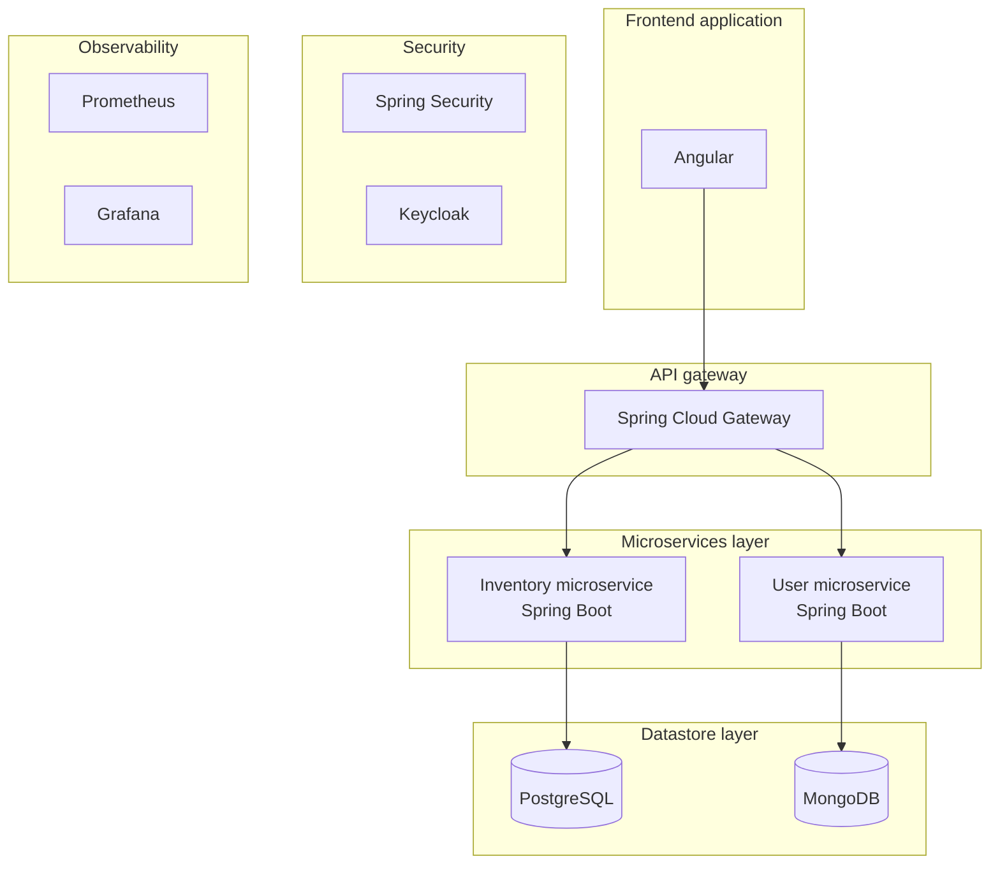
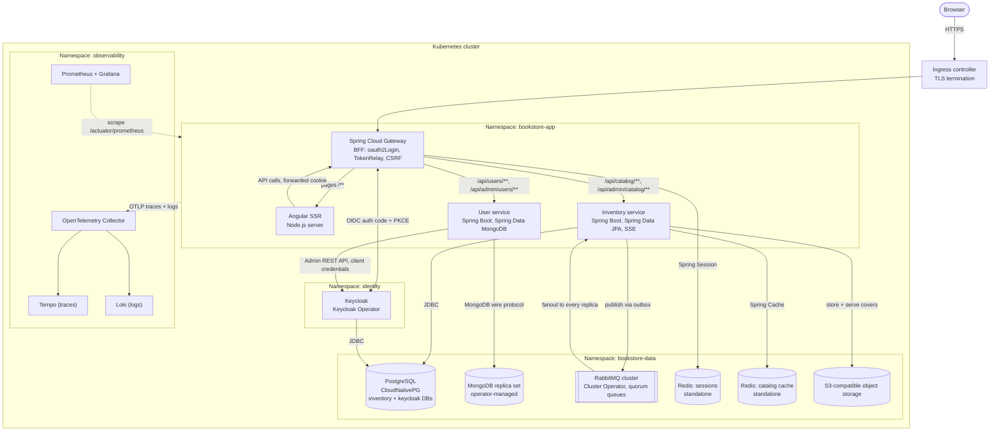
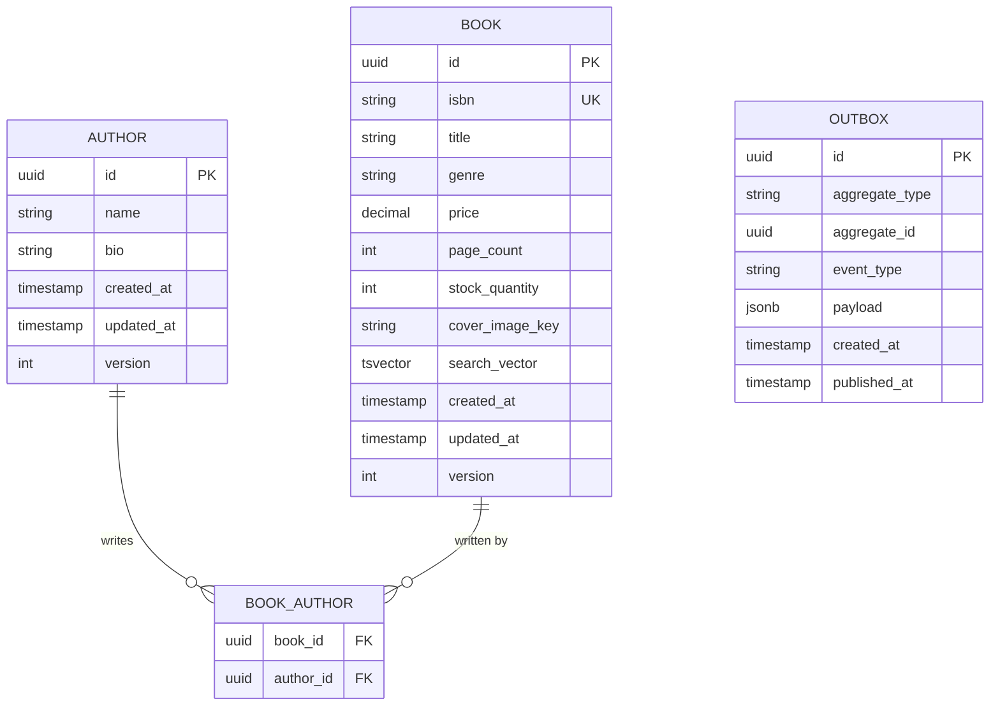
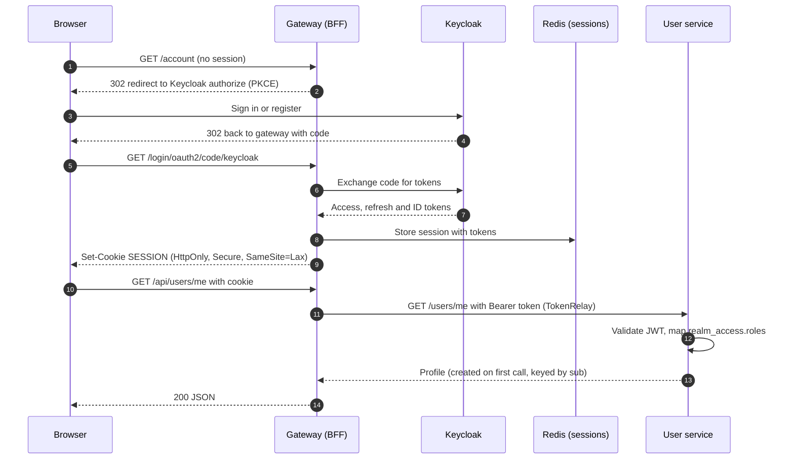
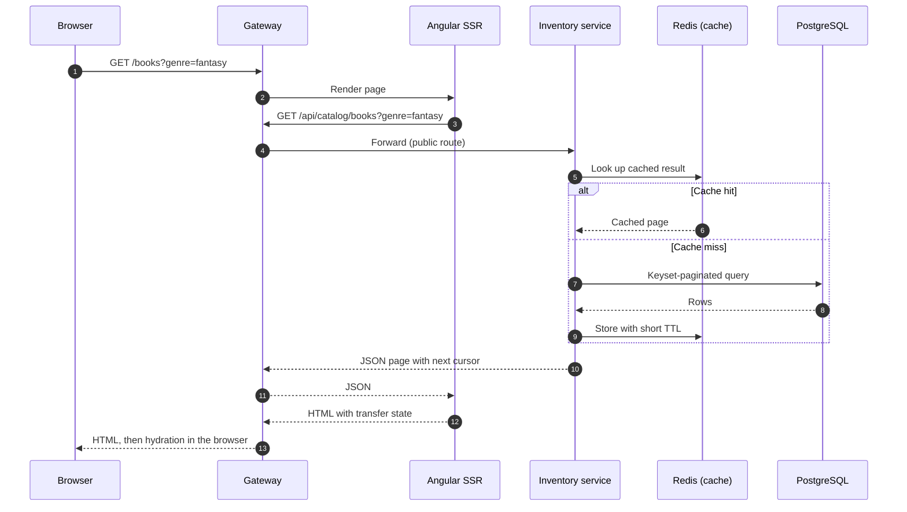
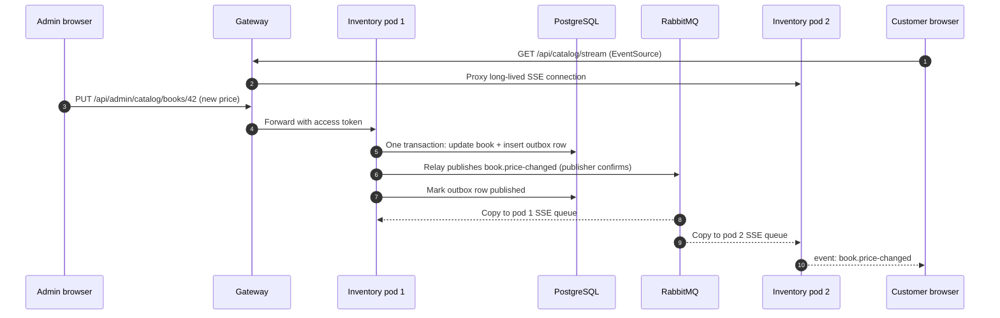
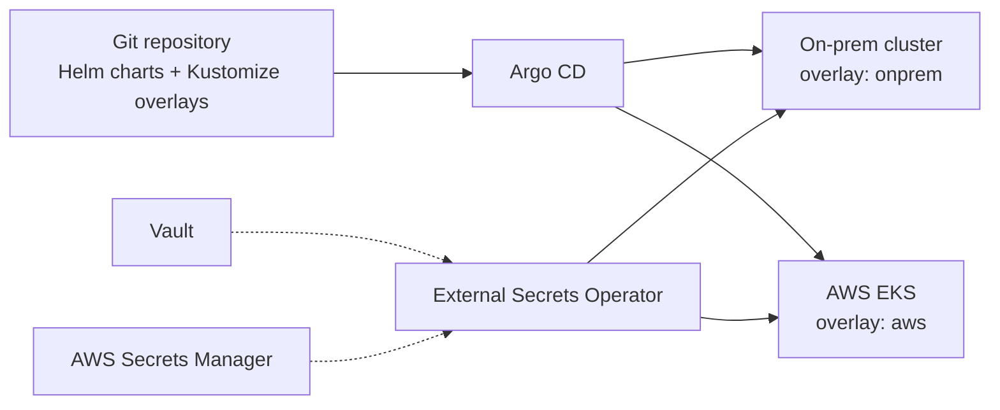

# Bookstore platform — architecture

## Summary

The bookstore platform is an online book catalog with an administrative back office.

**For customers**, it offers a paginated catalog of books that can be filtered by genre, sorted, and searched by title or author. Anyone can browse; signing in lets a customer manage their own profile (name, phone, address and preferences). Changes made by administrators — a new title or a price change — appear on open catalog pages in real time, without a page refresh. Public catalog pages are rendered on the server, so they load quickly and can be indexed by search engines.

**For administrators**, it provides catalog management (creating and updating books with title, ISBN, price, genre, page count, stock level and cover image, and the authors attached to them) and user administration (creating accounts and assigning roles). Every admin edit is recorded in an audit log.

**How it is built.** Two Spring Boot services sit behind a Spring Cloud Gateway, with an Angular frontend. The **inventory service** owns books, authors and cover images, stored in PostgreSQL and S3‑compatible object storage. The **user service** owns customer profiles, stored in MongoDB. **Keycloak** handles identity: registration, sign‑in, credentials and the `USER` and `ADMIN` roles. The **gateway** is the single entry point and acts as a backend‑for‑frontend: it runs the sign‑in with Keycloak, keeps tokens on the server, and gives the browser only an HttpOnly session cookie, with sessions held in Redis. Catalog changes are written together with a transactional outbox, published to **RabbitMQ**, and pushed to browsers over Server‑Sent Events.

**Where it runs.** Everything runs on Kubernetes — on‑prem first, with AWS as a later target. Each dependency is reached through an open protocol (JDBC, the MongoDB wire protocol, AMQP 0‑9‑1, the S3 API, OIDC), and each stateful component runs under an operator that behaves the same on both platforms, so moving to AWS is a configuration change rather than a code change.

**Not in the first release:** payments, orders and checkout, a CDN, Redis high availability and a dedicated search engine (see §7).

---

## 1. Starting point: original sketch

The first whiteboard, tidied. It established the layers and the main technology choices; security and observability were listed as separate concerns without flows. Section 2 shows how everything connects.



---

## 2. System diagram

The full system as designed: request paths, identity, messaging, data stores and observability, grouped by Kubernetes namespace.



---

## 3. Service breakdown

### 3.1 Components

| Component | Responsibility | Key libraries |
| --- | --- | --- |
| **Spring Cloud Gateway (BFF)** | Single entry point. Runs the OIDC login with Keycloak, keeps tokens server‑side, issues an HttpOnly session cookie, relays the access token downstream, enforces CSRF, passes SSE streams through unbuffered. | `spring-cloud-starter-gateway`, `spring-boot-starter-oauth2-client`, `spring-session-data-redis` |
| **Angular SSR** | Renders public catalog pages server‑side for SEO and first‑paint speed; hydrates in the browser. Forwards the incoming `Cookie` header on its own API calls so signed‑in pages can render too. Opens the SSE `EventSource` in the browser only. | Angular SSR, NgRx SignalStore |
| **Inventory service** | Books, authors, stock levels, cover‑image upload and serving (with long `Cache-Control` headers), catalog search (Postgres full‑text + `pg_trgm`). Writes domain events to an outbox, publishes them to RabbitMQ, and serves the SSE stream. | Spring MVC, Spring Data JPA, Flyway, Spring AMQP, `SseEmitter` |
| **User service** | App‑specific profile data (phone, address, preferences) keyed by the Keycloak `sub`. Admin user management delegated to the Keycloak Admin API. | Spring MVC, Spring Data MongoDB, Keycloak admin client |
| **Keycloak** | Identity: registration, login, credentials, realm roles (`USER`, `ADMIN`), themed login pages. | Keycloak Operator, realm config as code |
| **PostgreSQL** | Separate databases and credentials for `inventory` and `keycloak`. | CloudNativePG |
| **MongoDB** | `users` database, single `profiles` collection. | Percona Operator for MongoDB or MongoDB Community Operator |
| **RabbitMQ** | Catalog domain events; fan‑out to SSE replicas; durable queues for future async consumers. | RabbitMQ Cluster Operator |
| **Redis (two standalone instances)** | `redis-sessions`: shared gateway sessions, so any gateway replica can serve any user. `redis-cache`: optional catalog read cache for the inventory service. No replication or Sentinel to start with; each instance can fail or be restarted without affecting the other. | One StatefulSet (or Helm release) per instance |
| **Object storage** | Book cover images, referenced by key from Postgres. Browsers fetch covers through the inventory service; the store itself is not exposed. | Any S3‑compatible store |

### 3.2 Request routing

| Path | Routed to | Auth |
| --- | --- | --- |
| `/oauth2/**`, `/login/**`, `/logout` | Gateway (handled locally) | — |
| `/**` (pages) | Angular SSR | Optional session |
| `/api/catalog/**` (GET) | Inventory | Public |
| `/api/catalog/stream` | Inventory (SSE) | Public |
| `/api/admin/catalog/**` | Inventory | `ADMIN` |
| `/api/users/me/**` | User service | `USER` |
| `/api/admin/users/**` | User service | `ADMIN` |

Authorization is checked twice: the gateway rejects anonymous calls to protected routes, and each service validates the JWT as an OAuth2 resource server and enforces roles with `@PreAuthorize`. Angular route guards only shape the UI.

### 3.3 Data ownership and model

Each service owns its data store; no service reads another service’s database.

#### Inventory (PostgreSQL)



- `price` is `NUMERIC(10,2)` in Postgres and `BigDecimal` in Java.
- `isbn` is unique and validated (ISBN‑13 check digit) on write.
- `version` enables JPA optimistic locking so two admins cannot silently overwrite each other.
- Indexes: `genre`, `price`, `created_at` for filtering and sorting; GIN on `search_vector`; trigram GIN on `title` for fuzzy search.
- Pagination is keyset (cursor) based, ordered by the sort column plus `id`.
- An `audit_log` table (who changed what, when) records admin edits.

#### Users (MongoDB)

Collection `profiles`, one document per Keycloak user:

```json
{
  "_id": "keycloak-sub-uuid",
  "displayName": "…",
  "phone": "…",
  "address": { "line1": "…", "city": "…", "postalCode": "…", "country": "…" },
  "preferences": { "favouriteGenres": ["…"], "newsletter": false },
  "createdAt": "2026-10-20T00:00:00Z",
  "updatedAt": "2026-10-20T00:00:00Z",
  "version": 1
}
```

- Email, name and roles stay in Keycloak (the source of truth); they are not duplicated here.
- Documents are upserted lazily on a user’s first authenticated request.
- `@Version` gives optimistic locking; writes use majority write concern.

---

## 4. Data flows

### 4.1 Signing in (BFF authentication)



Implementation notes:

- **Roles mapping.** Keycloak places realm roles in `realm_access.roles`. Each resource server needs a custom `JwtAuthenticationConverter` to turn them into `ROLE_*` authorities.
- **Issuer consistency.** Set `KC_HOSTNAME` to the public URL so the `iss` claim never changes. Services validate `issuer-uri` against the public URL but fetch keys from the in‑cluster `jwk-set-uri`.
- **CSRF.** Cookie sessions require CSRF protection. Use the gateway’s cookie‑based CSRF token repository; Angular’s `HttpClient` sends the `X-XSRF-TOKEN` header automatically.
- **Token refresh** happens inside the gateway; the browser never sees a token.
- **Session lifetime.** Keep the Spring Session timeout at or below Keycloak’s SSO session idle timeout, so a gateway session never outlives the Keycloak session behind it.
- **Logout** ends the gateway session and calls Keycloak’s end‑session endpoint (RP‑initiated logout). Enable back‑channel logout so sessions ended in Keycloak also end at the gateway.
- **User service → Keycloak** uses a dedicated confidential client with only the `manage-users` and `view-users` roles of `realm-management`.

### 4.2 Browsing the catalog (read path)



- The SSR server passes the fetched data to the browser as transfer state, so hydration does not repeat the API call.
- When an inventory replica receives a catalog event from RabbitMQ (§4.3), it evicts the affected cache entries; the short TTL is a backstop.

### 4.3 Real‑time catalog updates (outbox, RabbitMQ, SSE)



#### RabbitMQ topology

| Element | Type | Purpose |
| --- | --- | --- |
| `catalog.events` | Topic exchange, durable | All catalog domain events. Routing keys: `book.created`, `book.updated`, `book.price-changed`, `book.deleted`, `author.*` |
| `catalog.sse.<pod-name>` | Classic queue, exclusive, auto‑delete | One per inventory replica, bound to `book.#`. Disappears with the pod; SSE clients reconnect and reload state. |
| `catalog.<consumer>` | Quorum queue, durable | Template for future async consumers (email notifications, search indexing). |
| `catalog.events.dlx` | Dead‑letter exchange | Receives messages rejected after retries from durable queues. |

#### Outbox and SSE notes

- **Outbox table** lives in the inventory database. A scheduled relay (or Spring Modulith’s event publication registry with AMQP externalization) publishes unsent rows with publisher confirms, then marks them sent. Delivery is at‑least‑once, so every event carries an `eventId` and consumers deduplicate.
- **SSE endpoint** uses Spring MVC `SseEmitter` with virtual threads enabled; no WebFlux, because JPA is blocking.
- **Heartbeat** comment line every 15–20 seconds so proxies do not close idle streams.
- **Timeouts and buffering.** The ingress controller and Spring Cloud Gateway must allow long‑lived responses and disable response buffering on the stream route.
- **Reconnects.** Send an `id:` with every event; the browser’s `EventSource` reconnects automatically and the client refetches the visible page on reconnect.

---

## 5. Tech stack

| Layer | Choice | Notes |
| --- | --- | --- |
| Language and runtime | Java 25 (LTS) | Virtual threads enabled for the MVC services and SSE |
| Backend framework | Spring Boot 4.1.x | Spring Framework 7 and Jakarta EE 11; Jackson 3 is the default and auto‑configuration is split into smaller modules, so use the Boot 4 starters throughout |
| Gateway | Spring Cloud Gateway | Use the Spring Cloud release train that matches the Boot version |
| Security | Spring Security: OAuth2 client (gateway), OAuth2 resource server (services) | Custom `JwtAuthenticationConverter` for Keycloak roles |
| Inventory persistence | Spring Data JPA (Hibernate), Flyway | PostgreSQL full‑text search plus `pg_trgm` for catalog search |
| User persistence | Spring Data MongoDB | Optimistic locking with `@Version` |
| Messaging | Spring AMQP | Outbox relay as a scheduled job or Spring Modulith event externalization |
| Sessions and cache | Spring Session Data Redis, Spring Cache with Redis | Two separate Redis instances (§6.3) |
| API documentation | springdoc‑openapi (Boot 4‑compatible line) | One OpenAPI document per service |
| Frontend | Angular 22 with SSR and incremental hydration | NgRx SignalStore for state, reactive forms for input |
| Identity provider | Keycloak | Realm, clients and roles kept as code |
| Databases | PostgreSQL, MongoDB (replica set) | Separate databases and credentials per owner |
| Message broker | RabbitMQ | Quorum queues for durable consumers |
| Session and cache store | Redis | Standalone instances to start with |
| Object storage | Any S3‑compatible store | Accessed through the AWS SDK v2 S3 client |
| Observability | Micrometer, OpenTelemetry Java agent, Prometheus, Grafana, Tempo, Loki |  |
| Build and test | Maven or Gradle; JUnit 5; Testcontainers | Testcontainers modules for PostgreSQL, MongoDB, RabbitMQ, Redis and Keycloak |
| Delivery | Helm, Kustomize, Argo CD, External Secrets Operator | §6.1 |

---

## 6. Infrastructure

### 6.1 Approach: on‑prem Kubernetes first, AWS later

**Phase 1 — on‑prem.** The whole platform, including the stateful services, runs inside the on‑prem Kubernetes cluster:

- **Namespaces:** `bookstore-app` (gateway, SSR, services), `identity` (Keycloak), `bookstore-data` (PostgreSQL, MongoDB, RabbitMQ, Redis, object storage) and `observability`.
- **Stateful services** run under Kubernetes operators (CloudNativePG, a MongoDB operator, the RabbitMQ Cluster Operator, the Keycloak Operator), which handle provisioning, failover and backups the same way on any cluster.
- **Traffic** enters through the cluster’s existing ingress controller, which terminates TLS and forwards to the gateway.
- **Persistent volumes** come from a named StorageClass, so workloads never depend on a particular storage backend.
- **Delivery** is GitOps: Argo CD syncs one set of Helm charts, with environment differences held in Kustomize overlays. Secrets come from External Secrets Operator.

**Phase 2 — AWS.** The same charts deploy to EKS through an `aws` overlay. Everything can first run in‑cluster exactly as on‑prem; each component can then move to a managed AWS service one at a time where that is worth it (§6.2). A sensible order is object storage to S3 first (a configuration‑only change), then PostgreSQL and Redis to managed services if operating them in‑cluster becomes a burden. Keycloak and the application services stay in Kubernetes on both platforms.



### 6.2 Infrastructure portability

#### Portability map

| Concern | On‑prem | AWS, Kubernetes‑native | AWS, managed alternative | What keeps it portable |
| --- | --- | --- | --- | --- |
| PostgreSQL | CloudNativePG | CloudNativePG on EKS | RDS / Aurora PostgreSQL | Plain JDBC; only `pg_trgm` extension used |
| MongoDB | Percona or Community operator | Same operator on EKS | MongoDB Atlas on AWS | Standard MongoDB driver; avoid DocumentDB, whose API compatibility is partial |
| RabbitMQ | Cluster Operator | Cluster Operator on EKS | Amazon MQ for RabbitMQ (check plugin and quorum‑queue support first) | AMQP 0‑9‑1 via Spring AMQP |
| Redis | Two standalone instances (sessions, cache) | Same on EKS | ElastiCache (Redis OSS‑compatible engine) | Redis protocol via Spring Data Redis; check the self‑hosted Redis license (AGPLv3 / RSALv2 / SSPL) with your legal team |
| Object storage | Ceph RGW, SeaweedFS or Garage | — | Amazon S3 | AWS SDK v2 S3 client with endpoint override and path‑style access as config |
| Keycloak | Keycloak Operator | Keycloak Operator on EKS | — (no managed equivalent) | Database is the only external dependency |
| Ingress | Existing ingress controller | AWS Load Balancer Controller | — | Standard Ingress / Gateway API resources |
| Secrets | External Secrets + Vault | External Secrets + Secrets Manager | — | Apps read Kubernetes Secrets only |
| Storage | Ceph / Longhorn StorageClass | EBS CSI (gp3) | — | Workloads request a StorageClass by name |
| Observability | kube‑prometheus‑stack, Loki, Tempo | Same | Amazon Managed Prometheus / Grafana | OpenTelemetry and Prometheus exposition format |

#### Portability rules

1. Business code never imports a cloud SDK. Storage access sits behind one small `CoverImageStore` interface.
2. Every endpoint, credential and bucket name comes from environment variables or Secrets; Spring profiles never contain environment‑specific URLs.
3. One set of Helm charts; environment differences live only in Kustomize overlays.
4. Each service gets its own database, credentials and Kubernetes ServiceAccount.
5. NetworkPolicies allow only the arrows in the overview diagram (for example, only the inventory service can reach PostgreSQL’s inventory database, and only the user service can reach MongoDB).

### 6.3 Redis strategy

The platform starts with **two independent, standalone Redis instances** rather than one shared or highly available deployment. The two workloads have different needs, so separating them gives each the right configuration and keeps a failure in one from affecting the other.

|  | `redis-sessions` | `redis-cache` |
| --- | --- | --- |
| Used by | Gateway (Spring Session) | Inventory service (Spring Cache) |
| Holds | Signed‑in user sessions, including OAuth2 tokens | Catalog query results and book details |
| `maxmemory-policy` | `noeviction` — evicting sessions would sign users out at random | `allkeys-lru` |
| Persistence | AOF (`appendfsync everysec`) on a persistent volume | None |
| Expiry | Session timeout at or below Keycloak’s SSO idle timeout | Short TTL (minutes), plus eviction on catalog events |
| Network access | Gateway only, enforced by NetworkPolicy | Inventory service only, enforced by NetworkPolicy |
| If it fails | Users are redirected to Keycloak and, because their Keycloak session is still alive, signed straight back in without re‑entering credentials | Reads fall through to PostgreSQL until the cache warms up |

**Operating notes**

- Each instance is its own StatefulSet (or Helm release) with a password‑protected ACL user; neither is exposed outside the cluster. The sessions instance holds tokens, so treat it as sensitive data.
- Monitor memory use, evictions, connected clients and AOF rewrite status for both instances.
- Self‑hosted Redis is licensed under AGPLv3, RSALv2 or SSPL; confirm with your legal team that running it unmodified as internal infrastructure is acceptable.

**When to add high availability.** Move to Redis Sentinel (a primary with replicas) or a managed service such as ElastiCache with replication when any of these becomes true: the silent re‑login after a sessions restart is no longer acceptable (for example, Keycloak session timeouts are shortened), node maintenance must not interrupt sessions at all, or catalog traffic depends on the cache to keep PostgreSQL load manageable. Spring Session and Spring Data Redis support Sentinel and replication through configuration alone, so the change needs no code changes.

### 6.4 Observability

- **Metrics:** Micrometer → `/actuator/prometheus`, scraped via ServiceMonitors. Dashboards for HTTP latency per route, JVM, HikariCP pools, RabbitMQ queue depth and outbox lag (oldest unpublished row), active SSE connections.
- **Traces:** OpenTelemetry Java agent on gateway and services → Collector → Tempo. Trace context propagates through RabbitMQ message headers, so a price change can be followed from the admin request to the SSE push.
- **Logs:** JSON logs with `traceId` and `spanId` → Loki, linked from Grafana traces.
- **Alerts (starting set):** 5xx rate per route, p95 latency, outbox lag over 60 seconds, dead‑letter queue non‑empty, Keycloak login failures spike, database replication lag.

---

## 7. Out of scope (for now)

Payments and PCI scope, orders and checkout, a CDN (cover URLs come from a configurable base URL, so one can be added later without code changes), Redis high availability (Sentinel or replication), a dedicated search engine (revisit if Postgres full‑text search falls short), multi‑region deployment.